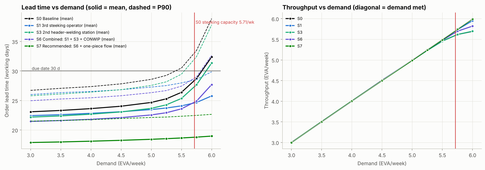
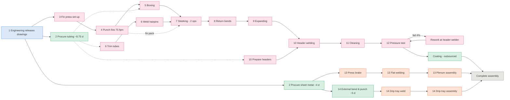
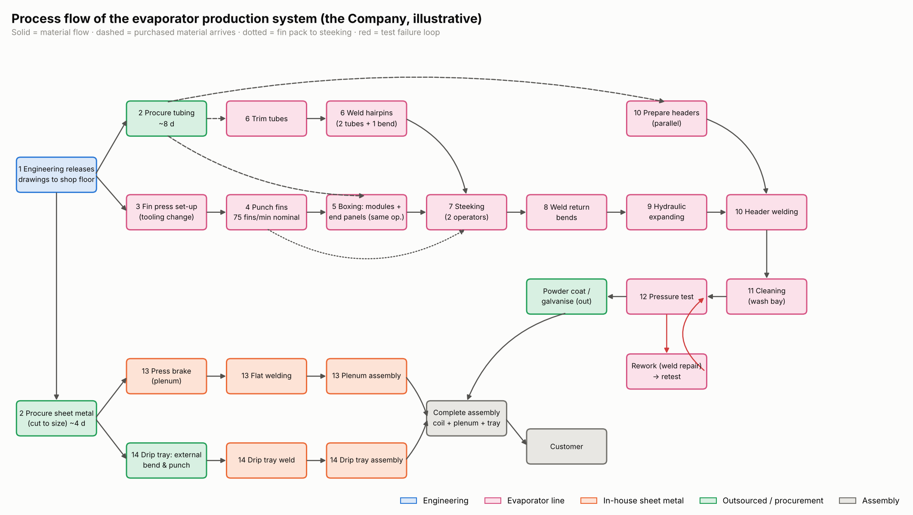
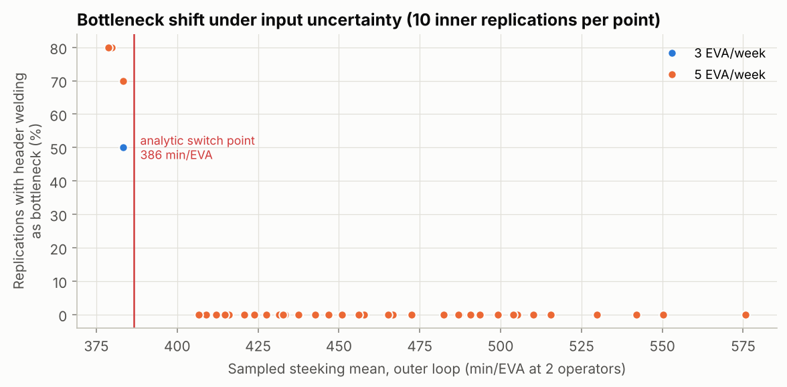

# Discrete-Event Simulation and Monte Carlo Analysis of an Evaporator Production System

**A VSM-based stochastic network model of an evaporator line and its sheet-metal and outsourced feeder flows. It reproduces the hand-calculated VSM, ranks the bottlenecks and compares improvement scenarios with statistical confidence.**

[](https://github.com/fadeelphillips29-cmd/facility-materials-handling-optimization/actions/workflows/evaporator-line-des-ci.yml)


> [!IMPORTANT]
> **Illustrative and anonymised data.** The organisation is called "the
> Company". All times, probabilities and lead times are illustrative or
> anonymised inputs from a whiteboard-style time study and engineering
> assumptions. They are **not measured company data**. The global
> `time_scale_factor` in `config/line_parameters.yaml` rescales every
> process time before publication.

---

## Contents

1. [Problem statement and objectives](#1-problem-statement-and-objectives)
2. [Key results](#2-key-results)
3. [Process description](#3-process-description)
4. [Station data](#4-station-data)
5. [The equations](#5-the-equations)
6. [Model overview](#6-model-overview)
7. [Repository structure](#7-repository-structure)
8. [Installation and quick start](#8-installation-and-quick-start)
9. [How to operate the model](#9-how-to-operate-the-model)
10. [Inputs reference](#10-inputs-reference)
11. [Outputs reference](#11-outputs-reference)
12. [Verification and validation](#12-verification-and-validation)
13. [Scenario results and recommendations](#13-scenario-results-and-recommendations)
14. [Limitations and future work](#14-limitations-and-future-work)
15. [Build phases](#15-build-phases)
16. [Tech stack and skills demonstrated](#16-tech-stack-and-skills-demonstrated)
17. [License and author](#17-license-and-author)

---

## 1. Problem statement and objectives

The Company builds evaporators (EVA) in work orders of three. Each EVA passes
through a fin press, tube preparation, **steeking** (lacing circuits through the
fin pack), welding, expansion, washing and pressure testing. It is then joined
with an in-house plenum and an externally formed drip tray. A hand-calculated
value stream map identified steeking (7 h per EVA, 2 operators) as the
bottleneck, with header welding (6.4 h per EVA) close behind. The steeking time
is only an *estimate*: stakeholder guesses ranged from 6 h to 20 h.

Management wants to know:

* Does a stochastic model reproduce the whiteboard VSM, and how much lead time
  do variability, queues and batching add?
* Which resource is the bottleneck, how sure are we, and does it shift?
* Which improvement pays off: a 3rd steeker, standard work, a 2nd header
  welder, fin-press SMED/TPM, one-piece flow, or CONWIP release? At what
  demand level does lead time "explode"?
* How much of the uncertainty comes from not knowing the steeking time?

**Objectives.** (1) Analytical model: fin-press OEE equations, weld-station
metrics, bottleneck, Kingman. (2) A validated SimPy model of the network,
including joins, shared operators and outsourcing. (3) Monte Carlo with common
random numbers and a two-level input-uncertainty loop. (4) Scenarios, a demand
sweep and sensitivity analysis with 95 % CIs. (5) Current-state and
future-state VSMs and a what-if dashboard.

## 2. Key results

All numbers below are generated from `results/*.csv` by `make report`.

<!-- BEGIN:headline -->
| KPI | S0 @ 3/wk | S7 @ 3/wk | S0 @ 5/wk | S7 @ 5/wk |
|---|---|---|---|---|
| Throughput (EVA/week) | 2.99 (±0.013) | 2.99 (±0.012) | 4.98 (±0.015) | 4.98 (±0.016) |
| Order lead time, mean (working days) | 23.1 (±0.05) | 17.9 (±0.04) | 24.7 (±0.06) | 18.4 (±0.04) |
| Order lead time, P95 (working days) | 28.2 (±0.14) | 22.9 (±0.13) | 30.1 (±0.14) | 23.6 (±0.11) |
| On-time delivery (6-week promise) | 97.2 % (±0.26) | 99.8 % (±0.06) | 94.2 % (±0.35) | 99.8 % (±0.06) |
| WIP in system (EVA) | 13.7 (±0.06) | 10.1 (±0.05) | 24.4 (±0.11) | 17.4 (±0.07) |
| Value-added ratio | 20.2 % (±0.04) | 26.1 % (±0.07) | 18.8 % (±0.05) | 25.3 % (±0.05) |
| Bottleneck (share of replications) | Steeking (100 %) | Steeking (100 %) | Steeking (100 %) | Steeking (100 %) |
| Paired lead-time change vs S0 (95 % CI) | - | -5.24 d [-5.27, -5.22] = -22.7 % | - | -6.28 d [-6.31, -6.24] = -25.4 % |

_Mean (± 95 % CI half-width) over 300 replications of 52 measured weeks; common random numbers; S7 = S6 (3rd steeker + 2nd header welder + CONWIP) + one-piece flow. Source: `results/scenario_summary.csv`, `results/scenario_paired_differences.csv`._
<!-- END:headline -->

**Bottleneck ranking** (hand calculation vs simulation):

<!-- BEGIN:bottleneck_ranking -->
| Rank | Resource | Load (min/EVA) | Capacity (EVA/wk) | Hand-calc util. @ 3/wk | Simulated @ 3/wk | Simulated @ 5/wk | Mean queue @ 5/wk (h) |
|---|---|---|---|---|---|---|---|
| 1 | Steeking crew | 420.0 | 5.71 | 52.5 % | 52.3 % | 87.1 % | 20.2 |
| 2 | Header welder | 384.0 | 6.25 | 48.3 % | 48.2 % | 80.3 % | 7.0 |
| 3 | Hairpin welder | 216.0 | 11.11 | 27.0 % | 26.9 % | 44.9 % | 5.6 |
| 4 | Fin press / boxing operator | 176.2 | 13.62 | 22.0 % | 22.0 % | 36.6 % | 2.0 |
| 5 | Final assembly crew | 150.0 | 16.00 | 18.8 % | 18.7 % | 31.1 % | 2.8 |
| 6 | Return-bend welder | 144.0 | 16.67 | 18.0 % | 17.9 % | 29.9 % | 2.4 |
| 7 | Header preparation | 120.0 | 20.00 | 15.0 % | 15.0 % | 24.9 % | 2.6 |
| 8 | Sheet-metal assembler | 105.0 | 22.86 | 13.1 % | 13.1 % | 21.8 % | 1.0 |
<!-- END:bottleneck_ranking -->

**In short.**
- **Baseline.** The baseline meets the current demand of 3 EVA/week with a
  mean order lead time of about 23 working days. More than half of that is
  purchasing and outsourcing delay (tubing ~8.75 d, coating 3 d, drawing
  release 1 d).
- **Bottleneck.** Steeking is the bottleneck in every replication. Its
  capacity is 5.71 EVA/week.
- **Where lead time explodes.** Lead time stays flat up to about 5 EVA/week,
  rises from 5.5 EVA/week, and **explodes at 5.75-6 EVA/week**, where steeking
  utilisation reaches 98-100 % and the backlog grows without limit.
- **Best lever for lead time.** One-piece flow (S5) is the largest single
  lever and needs no capital.
- **Bottleneck shift.** A 3rd steeker (S1) **moves the bottleneck to header
  welding**.
- **Recommendation.** S7 (S1 + S3 + CONWIP + one-piece flow) cuts lead time by
  about a quarter and keeps the line stable to 6 EVA/week.
- **Fin press.** Raising fin-press OEE from 70 % to 85 % (S4) has **exactly
  zero** effect: the fin press has days of slack.
- **Steeking uncertainty.** Not knowing the steeking time is the dominant risk
  at 5 EVA/week. It drives most of the lead-time variance there (see
  [§13](#13-scenario-results-and-recommendations)).

| Demand curve (the "hockey stick") | Scenario comparison |
|---|---|
|  |  |


## 3. Process description

| # | Step | Department |
|---|---|---|
| 1 | Engineering releases drawings to the shop floor (sheet metal and evaporator line) | Engineering (blue) |
| 2 | Procurement orders sheet metal cut to size (plenum, drip tray) and tubing | Outsourced (green) |
| 3 | In parallel, the fin-press operator sets up the fin press (tooling change) | Evaporator line (pink) |
| 4 | The operator feeds stainless-steel strip and punches fins (nominal 75 fins/min) | Evaporator line |
| 5 | The same operator sets up the modules (tubes) and laces tubes through the end panels ("Boxing") | Evaporator line |
| 6 | At a separate station one welder joins 2 tubes with 1 bent tube into a circuit ("Weld Hairpins", fed by "Trim Tubes") | Evaporator line |
| 7 | Two operators lace the circuits through the stacked fins ("Steeking") | Evaporator line |
| 8 | Return-bend welding | Evaporator line |
| 9 | Hydraulic expansion | Evaporator line |
| 10 | Header welding. Headers are prepared in parallel ("Prepare Headers") | Evaporator line |
| 11 | Cleaning (wash bay) | Evaporator line |
| 12 | Pressure testing. Failures go to rework and then a retest | Evaporator line |
| 13 | Plenum: press-brake bending, flat welding, then plenum assembly | In-house sheet metal (orange) |
| 14 | Drip tray: plates go to an external manufacturer (bend & punch), then are welded and assembled in-house | Outsourced → sheet metal |
| - | Outsourced powder coating / galvanising of the coil (`include_outsourced_coating`) | Outsourced |
| - | Complete assembly: coil + plenum + drip tray (join) | Assembly (grey) |

> The original flowchart shows pressure testing *before* washing, but the
> written steps put cleaning first. The model follows the written steps by
> default (`wash_before_test: true`), and supports the other order.



**Colour code** (used in every diagram): blue = engineering, pink = evaporator
line, orange = in-house sheet metal, green = outsourced, grey = assembly.



## 4. Station data

Hand-calculated deterministic VSM table (`results/vsm_hand_calc.csv`, demand
3 EVA/week, BN = bottleneck). The resource utilisation loads shared operators
with all of their activities:

<!-- BEGIN:hand_calc -->
| Step | Process | Dept | Source | Min/EVA | Min/3 EVA | Ops | Labour min/EVA | EVA/shift | EVA/week | Resource util. @ demand |
|---|---|---|---|---|---|---|---|---|---|---|
| 1 | Engineering drawing release | engineering | assumed | - | 1 d | - | - | - | - | - |
| 2 | Procure sheet metal (cut to size) | outsourced | assumed | - | 4 d | - | - | - | - | - |
| 2 | Procure tubing | outsourced | assumed | - | 8.75 d | - | - | - | - | - |
| 3 | Fin Press (setup + punching) | evaporator | time study | 76.2 | 228.6 | 1 | 76.2 | 6.30 | 31.50 | 22.0 % |
| 5 | Boxing (modules + end panels) | evaporator | assumed | 100.0 | 300.0 | 1 | 100.0 | 4.80 | 24.00 | 22.0 % |
| 6 | Trim Tubes | evaporator | assumed | 40.0 | 120.0 | 1 | 40.0 | 12.00 | 60.00 | 5.0 % |
| 6 | Weld Hairpins | evaporator | time study | 216.0 | 648.0 | 1 | 216.0 | 2.22 | 11.11 | 27.0 % |
| 7 | Steeking | evaporator | estimate | 420.0 | 1,260.0 | 2 | 840.0 | 1.14 | 5.71 | 52.5 % **(BN)** |
| 8 | Weld Return Bends | evaporator | time study | 144.0 | 432.0 | 1 | 144.0 | 3.33 | 16.67 | 18.0 % |
| 9 | Hydraulic Expanding | evaporator | time study | 87.0 | 261.0 | 1 | 87.0 | 5.52 | 27.59 | 10.9 % |
| 10 | Prepare Headers | evaporator | assumed | 120.0 | 360.0 | 1 | 120.0 | 4.00 | 20.00 | 15.0 % |
| 10 | Header Welding | evaporator | time study | 384.0 | 1,152.0 | 1 | 384.0 | 1.25 | 6.25 | 48.0 % |
| 11 | Wash Bay | evaporator | assumed | 45.0 | 135.0 | 1 | 45.0 | 10.67 | 53.33 | 5.6 % |
| 12 | Pressure Test | evaporator | assumed | 90.0 | 270.0 | 1 | 90.0 | 5.33 | 26.67 | 11.2 % |
| 13 | Plenum: Press Brake | sheet_metal | assumed | 40.0 | 120.0 | 1 | 40.0 | 12.00 | 60.00 | 5.0 % |
| 13 | Plenum: Flat Welding | sheet_metal | assumed | 90.0 | 270.0 | 1 | 90.0 | 5.33 | 26.67 | 11.2 % |
| 13 | Plenum Assembly | sheet_metal | assumed | 60.0 | 180.0 | 1 | 60.0 | 8.00 | 40.00 | 13.1 % |
| 14 | Drip tray: external bend & punch | outsourced | assumed | - | 5 d | - | - | - | - | - |
| 14 | Drip Tray: Weld | sheet_metal | assumed | 100.0 | 300.0 | 1 | 100.0 | 4.80 | 24.00 | 12.5 % |
| 14 | Drip Tray Assembly | sheet_metal | assumed | 45.0 | 135.0 | 1 | 45.0 | 10.67 | 53.33 | 13.1 % |
| 15 | Powder coating / galvanising | outsourced | assumed | - | 3 d | - | - | - | - | - |
| 15 | Complete Assembly | assembly | assumed | 150.0 | 450.0 | 2 | 300.0 | 3.20 | 16.00 | 18.8 % |
<!-- END:hand_calc -->

Manual weld and expansion stations: metric 1 (t_op), metric 2 (n_ops,
ops/min) and metric 3 (min/coil), plus capacity:

<!-- BEGIN:weld_metrics -->
| Station | t_op (min) | ops/min | ops/h | n_ops/coil | min/coil | min per 3 EVA | Operators | EVA/shift | Util. @ 3/wk |
|---|---|---|---|---|---|---|---|---|---|
| Weld Hairpins | 4 | 0.250 | 15.0 | 54 | 216 | 648 (10.8 h) | 1 | 2.22 | 27.0 % |
| Weld Return Bends | 4 | 0.250 | 15.0 | 36 | 144 | 432 (7.2 h) | 1 | 3.33 | 18.0 % |
| Hydraulic Expanding | 3 | 0.333 | 20.0 | 24 | 87 | 261 (4.3 h) | 1 | 5.52 | 10.9 % |
| Header Welding | 8 | 0.125 | 7.5 | 48 | 384 | 1152 (19.2 h) | 1 | 1.25 | 48.0 % |
<!-- END:weld_metrics -->

## 5. The equations

Implemented in `src/evapsim/equations.py`, unit-tested in
`tests/test_equations.py`, and documented in `docs/MODEL_DESCRIPTION.md`.

**A. Fin press** (nominal rate r_n = 75 fins/min)

| # | Equation | Baseline value |
|---|---|---|
| A1 | $t_{ideal} = 1/r_n$ (and $r_n = s \cdot k$ for *s* strokes/min, *k* fins/stroke) | 0.8 s per fin |
| A2 | $F_g = F/Q$ (gross fins for *F* good fins) | 4,000 / 0.98 = 4,081.6 |
| A3 | $T_{run} = F_g / (r_n P)$ | 57.29 min/EVA |
| A4 | $T_{eva} = T_{run}/A_u + (F_g/R)\,t_r$, with $A_u = MTBF/(MTBF+MTTR)$ | A_u = 0.90 → 66.20 min |
| A5 | $T_{job} = S + B\,T_{eva}$ | 30 + 3 × 66.20 = **228.6 min** (whiteboard 229) |
| A6 | $OEE = B F t_{ideal} / T_{job} = A_{tot} P Q$, with $A_{tot} = B T_{run}/T_{job}$ | **69.99 %** |
| A7 | $r_{eff} = r_n \cdot OEE$, $N(t) = r_{eff}\,t$, $X = B/T_{job}$ | 52.5 fins/min |
| A8 | Calibration $F = OEE \cdot r_n \cdot T_{job}/B$ | 0.70 × 75 × 229 / 3 = 4,007.5 ≈ 4,000 |
| A9 | Stochastic: stops at rate 1/MTBF of run time, lognormal repairs (mean MTTR), lognormal setup (CV 0.25), Bernoulli(1-Q) scrap per fin | simulated mean within 1 % of T_job (test) |

The OEE options behind scenario S4:

<!-- BEGIN:fin_press -->
| Case | S (min) | P | Q | MTBF/MTTR (min) | t_r (min) | T_job (min/3 EVA) | OEE |
|---|---|---|---|---|---|---|---|
| baseline (calibrated) | 30 | 0.95 | 0.98 | 270/30 | 5 | 228.6 | 70.0 % |
| SMED only: setup -40% | 18 | 0.95 | 0.98 | 270/30 | 5 | 216.6 | 73.9 % |
| cap: setup -40%, A_u = P = 1 | 18 | 1 | 0.98 | 270/0 | 5 | 188.9 | 84.7 % |
| S4 package (SMED + TPM + quick reel change) | 18 | 0.985 | 0.99 | 540/10 | 2 | 188.1 | 85.0 % |
<!-- END:fin_press -->

**B. Manual weld/assembly stations.** Metric 1: $t_{op}$. Metric 2: $n_{ops}$
per coil and $1/t_{op}$ ops/min. Metric 3: $\text{min/coil} = n_{ops} t_{op} + t_{handling}$
and number of operators. Labour content = min/coil × operators. Capacity
(EVA/shift) = 480 · availability / (min/coil) × parallel stations.
Utilisation $\rho = \lambda t / (c \cdot \text{availability})$. Crew stations
use elapsed = labour / (crew · η(crew)) with η(2) = 1 and η(3) = 0.85, so
steeking with 3 operators takes 840 / 2.55 = 329.4 min.
Header welding: 8 min/weld, 0.125 welds/min (7.5/h), 48 welds/coil, 384
min/coil (6.4 h), 1,152 min per 3 EVA (19.2 h), 1 operator, 1.25 EVA per shift.

**C. System.**
- Bottleneck = $\arg\max_i (\text{min/EVA}_i / \text{parallel capacity}_i)$.
  Steeking: 1 EVA per 420 min = 1.14 EVA/shift = **5.71 EVA/week**.
- Little's law: $WIP = TH \times LT$.
- Kingman (VUT): $W_q = \frac{c_a^2 + c_s^2}{2} \cdot \frac{\rho}{1-\rho} \cdot t_e$.
- VSM value-added ratio = Σ value-added time / lead time.

## 6. Model overview

* **Entities.** Work orders of B = 3 EVA and the EVA themselves. Each order
  pre-draws all of its random numbers, so the same order meets the same
  random events in every scenario (common random numbers).
* **Resources.** 15 SimPy priority resources, each timing five states (busy,
  starved, blocked, down, changeover). Two of them are **shared**: the
  fin-press operator also does boxing, and one assembler does both plenum and
  drip-tray assembly. Steeking and final assembly are **crews**. The header
  welder also does **rework** (with priority).
* **Join logic.** Steeking waits for fin pack + boxed module + circuits.
  Header welding waits for the expanded coil + prepared headers. Complete
  assembly waits for coil + plenum + drip tray. The `test_join_never_starts_early`
  test checks this.
* **Flow control.** Process lot 3. Transfer batch 3 (baseline) or 1. Push
  release, or CONWIP on the coil line (card taken at tubing kitting, returned
  at test pass).
* **Calendar.** Working minutes (480 per day, 5 days per week). Procurement,
  external bending and coating are lognormal lead times in working days.
* **Main assumptions** (full register in [`docs/ASSUMPTIONS.md`](docs/ASSUMPTIONS.md)):
  - tube-dependent steps, including headers, wait for tubing;
  - pressure-test failures (4 %) are repaired by the header welder;
  - unlimited queues, so *blocked* is always 0;
  - an 8-week warm-up followed by 52 measured weeks;
  - the tubing lead time is **calibrated** from 8.0 to 8.75 days (A35).
* **Why DES + Monte Carlo?** The whiteboard VSM gives deterministic loads, but
  lead time is set by *interactions*: joins wait for the slowest branch, lots
  queue behind each other, a shared operator has to choose between two
  activities, and variability builds up as utilisation rises. DES represents
  those mechanisms directly. Monte Carlo turns one random year into a
  distribution with confidence intervals. A two-level loop separates *what we
  don't know* (the steeking time) from *what varies* (process variability).

## 7. Repository structure

```text
evaporator-line-des/
├── README.md · LICENSE · Makefile · requirements.txt · pyproject.toml · .gitignore
├── .github/workflows/ci.yml          ← ruff + pytest + pipeline smoke test
├── config/
│   ├── line_parameters.yaml          ← every input, with source tags + time_scale_factor
│   └── scenarios.yaml                ← S0-S7 overrides
├── data/
│   ├── time_study_samples.csv        ← 40 synthetic observations per operation
│   └── observed_weekly_output.csv    ← 26 "measured" weeks (perturbed model)
├── src/evapsim/
│   ├── config.py · equations.py · distributions.py · resources.py · model.py
│   ├── metrics.py · runner.py · scenarios.py · validation.py · sensitivity.py
│   ├── vsm.py · plots.py · input_analysis.py · datagen.py · pipeline.py · report.py · __main__.py
├── app/dashboard.py                  ← Streamlit what-if dashboard
├── notebooks/analysis.ipynb          ← executed walkthrough
├── results/                          ← CSV tables + figures/
├── docs/
│   ├── OPERATING_PROCEDURES.md · BUILD_PHASES.md · ASSUMPTIONS.md · MODEL_DESCRIPTION.md
│   └── process_flow.png · vsm_current.png · vsm_future.png
└── tests/                            ← 48 verification and regression tests
```

## 8. Installation and quick start

```bash
git clone https://github.com/fadeelphillips29-cmd/facility-materials-handling-optimization.git
cd facility-materials-handling-optimization/evaporator-line-des
python -m venv .venv && source .venv/bin/activate      # Windows: .venv\Scripts\activate
make setup          # requirements + editable install
make test           # ruff-clean code, 48 tests
make quick          # whole pipeline with 30 replications -> results/quick/
make all            # full pipeline (300 replications) + report + notebook
make dashboard      # http://localhost:8501
```

Individual steps: `make baseline`, `make scenarios`, `make sweep`,
`make sensitivity`, or `python -m evapsim --help`.

## 9. How to operate the model

The full SOP, with pre-run and sign-off checklists, is in
[`docs/OPERATING_PROCEDURES.md`](docs/OPERATING_PROCEDURES.md).

| Task | How |
|---|---|
| Run the baseline (hand calc → input analysis → Monte Carlo → validation → two-level MC) | `make baseline` (`QUICK=1` for 30 replications) |
| Scenarios S0-S7 at 3 and 5 EVA/week + VSMs | `make scenarios` |
| Demand sweep (hockey stick) | `make sweep` |
| Tornado + distribution robustness | `make sensitivity` |
| Change an operation time, crew, stations, batch, shift | edit `config/line_parameters.yaml` (§10), then `make test baseline` |
| Scale all process times (anonymisation) | `time_scale_factor: 0.8` |
| Define a scenario | add a block to `config/scenarios.yaml` (`extends`, `{scale: }`, `{add: }`) |
| What-if analysis | `make dashboard`, choose a scenario, edit inputs, press **Run** |
| Refresh documentation tables | `make report` |
| Verification mode | `simulation.deterministic: true`: the run reproduces the hand calculation exactly |
| Replace illustrative data | SOP §9: time study → `make input` → update YAML → validate/calibrate |

## 10. Inputs reference

Data dictionary with values and source tags: [`docs/ASSUMPTIONS.md` §1](docs/ASSUMPTIONS.md).

| Field | Unit | Range | Meaning |
|---|---|---|---|
| `time_scale_factor` | × | > 0 | multiplies every process time (operations, rework, fin-press setup, rate, reload, MTTR and MTBF). Calendar lead times are not scaled |
| `calendar.minutes_per_day`, `days_per_week` | min, days | > 0, ≥ 1 | productive time per shift, shifts per week |
| `demand.eva_per_week` | EVA/week | > 0 | demand; order interarrival = lot / demand weeks |
| `demand.interarrival_cv` | - | ≥ 0 | CV of order interarrival times (lognormal) |
| `demand.due_date_weeks` | weeks | > 0 | promised lead time for on-time delivery |
| `demand.sweep_eva_per_week`, `scenario_eva_per_week` | EVA/week | lists | sweep points, and the demand levels for scenarios |
| `orders.lot_size` | EVA | ≥ 1 | B, EVA per work order (= process lot) |
| `orders.transfer_batch` | EVA | 1..lot | EVA moved together between stations |
| `release.rule`, `conwip_limit_orders` | -, orders | push/conwip, ≥ 1 | release rule and CONWIP limit on the coil line |
| `flags.include_outsourced_coating`, `wash_before_test` | bool | - | coating leg on/off; wash/test order |
| `fin_press.nominal_rate_fpm` | fins/min | > 0 | r_n |
| `fin_press.good_fins_per_eva` | fins | > 0 | F |
| `fin_press.setup_min`, `setup_cv` | min, - | ≥ 0 | S per job, and its CV |
| `fin_press.performance`, `quality` | - | (0, 1] | P, Q |
| `fin_press.mtbf_min`, `mttr_min`, `mttr_cv` | min, -, - | > 0 | run-time MTBF, repair mean and CV |
| `fin_press.reel_fins`, `reload_min` | fins, min | > 0, ≥ 0 | R, t_r |
| `fin_press.resource` | id | defined resource | operator shared with boxing |
| `operations.<op>.mean_min` *or* `t_op_min`, `n_ops`, `handling_min` | min | > 0 | time per EVA (elapsed at `crew_basis`) |
| `operations.<op>.cv`, `distribution` | -, family | [0, 2], lognormal/gamma/weibull | variability and fitted family |
| `operations.<op>.resource`, `department`, `step`, `label`, `source`, `crew_basis` | - | see validation | routing and metadata |
| `resources.<id>.servers`, `crew`, `label` | count | ≥ 1 | parallel stations, crew size |
| `crew_efficiency` | η | (0, 1] | eta(crew) for crew stations |
| `lead_times.<key>.mean_days`, `cv`, `brief_mean_days`, `calibrated` | working days | ≥ 0 | engineering, procurement (sheet, tubing), external drip tray, coating |
| `rework.fail_prob`, `rework_min`, `cv`, `resource` | -, min | [0, 1), > 0 | pressure-test failure and repair |
| `simulation.measure_weeks`, `warmup_weeks` | weeks | ≥ 1, ≥ 0 | horizon |
| `simulation.replications`, `quick_replications`, `sensitivity_replications` | count | ≥ 2 | replication counts |
| `simulation.base_seed`, `deterministic` | int, bool | - | root seed; zero-variance verification mode |
| `input_uncertainty.enabled`, `steeking_triangular_min`, `outer_samples`, `inner_replications`, `steeking_cases_hours` | - | ordered triple | two-level Monte Carlo settings |
| `vsm.customer`, `vsm.supplier` | text | - | labels on the VSM |

## 11. Outputs reference

| Metric (column) | Definition |
|---|---|
| `throughput_eva_week` | EVA completed in the window / measured weeks |
| `attainment`, `weekly_compliance` | TH / demand; share of weeks with output ≥ demand |
| `lt_mean_days`, `lt_p50/p90/p95_days` | order lead time: last EVA complete − order arrival (working days) |
| `on_time` | share of orders completed within `due_date_weeks` |
| `wip_total`, `wip_<stage>` | time-average EVA in the system and per stage (engineering, awaiting material, prep, coil line, coating, final assembly) |
| `littles_wip` | λ · W: EVA completion rate × mean EVA lead time |
| `fpy_test` | 1 − first-test failures / first tests |
| `va_min_per_eva`, `va_ratio` | in-house processing minutes per EVA; VA / mean EVA lead time |
| `busy`, `changeover`, `down`, `blocked`, `starved`, `active` | share of server time per state; active = busy + changeover + down |
| `mean_wait_min` (per resource and station) | mean queue time, including waiting for the rest of the lot |
| `bottleneck`, `queue_bottleneck` | resource with the highest active share / longest mean queue, per replication |
| `diff_mean`, `diff_ci_low/high`, `p_value`, `crn_corr` | paired difference vs S0, 95 % t-interval, paired-t p, CRN correlation |
| `share_input`, `share_process` | variance-decomposition shares (two-level Monte Carlo) |
| `error_pct`, `prediction_interval_p` | validation error and empirical two-sided p-value |

## 12. Verification and validation

**Verification.** The deterministic simulation (zero variance, no stops, scrap
or test failures) reproduces the hand calculation **exactly**:

<!-- BEGIN:deterministic -->
| Case | Quantity | Hand calc | Simulated (min-max) | Exact |
|---|---|---|---|---|
| baseline (transfer batch 3) | order lead time (min) | 10848.00 | 10848.00 | yes |
| baseline (transfer batch 3) | utilisation: steeking_crew | 0.5250 | 0.5250 | yes |
| baseline (transfer batch 3) | utilisation: header_welder | 0.4800 | 0.4800 | yes |
| baseline (transfer batch 3) | utilisation: fin_press_operator | 0.2203 | 0.2203 | yes |
| baseline (transfer batch 3) | EVA per week | 3.0000 | 3.0000 | yes |
| baseline (transfer batch 3) | fin press job (min) | 228.61 | 228.61 - 228.61 | yes |
| transfer batch 1 | order lead time (min) | 8536.00 | 8536.00 | yes |

_19 of 19 checked quantities match exactly (all 15 resource utilisations included). Source: `results/deterministic_check.csv`._
<!-- END:deterministic -->

The stochastic fin press matches T_job within 1 % (A9). Little's law holds
(`wip_total` vs `littles_wip` in `results/baseline_kpis.csv`), EVA are
conserved, and joins never start early. Kingman agrees with the exact M/G/1
result on a single-station bench. In the network it brackets the simulated
steeking queue between its release-SCV and measured-SCV values at every demand
level (`results/kingman_check.csv`).

**Validation** against 26 observed weeks. Throughput equals demand in a stable
system, so lead time is the measure that discriminates between models. With
the brief's 8-day tubing lead time the model failed (−7.9 %, p = 0.02). The
tubing lead time was then calibrated with a minimum-change rule (A35):

<!-- BEGIN:validation -->
| Measure | Observed (26 wk) | Simulated | Error | Sim. 95 % PI | PI p | Welch p | Verdict |
|---|---|---|---|---|---|---|---|
| Mean weekly output (EVA/week) | 2.88 | 2.98 | +3.20 % | [2.65, 3.35] | 0.784 | 0.514 | valid |
| Mean order lead time (working days) | 24.28 | 23.14 | -4.70 % | [21.93, 24.45] | 0.093 | 0.104 | valid |
<!-- END:validation -->


## 13. Scenario results and recommendations

<!-- BEGIN:scenario_defs -->
| ID | Scenario | Change |
|---|---|---|
| S0 | Baseline | Current state: 2-person steeking crew, 1 header welder, push release, transfer batch 3. |
| S1 | 3rd steeking operator | Steeking crew 2 -> 3 (eta 0.85): elapsed 420 -> 329 min/EVA. |
| S2 | Steeking standard work / fixtures | Standard work and lacing fixtures cut steeking time by 20% (420 -> 336 min/EVA). |
| S3 | 2nd header-welding station | A second header-welding station and welder (2 parallel servers). |
| S4 | Fin press OEE 70% -> 85% | SMED (setup -40%) plus TPM and quality package: MTBF 540, MTTR 10, P 0.985, Q 0.99, 2-min reel change (OEE 85.0%). |
| S5 | One-piece flow (transfer batch 1) | EVA move individually between stations (process lot stays 3). |
| S6 | Combined: S1 + S3 + CONWIP | 3rd steeker, 2nd header welder and CONWIP release of the coil line (limit 3 work orders). |
| S7 | Recommended: S6 + one-piece flow | Extension beyond the brief: S6 capacity package plus transfer batch 1 (S5). |
<!-- END:scenario_defs -->

<!-- BEGIN:scenarios -->
| Demand | Scenario | TH (EVA/wk) | LT mean (d) | ΔLT vs S0 [95 % CI] | ΔLT % | p | LT P95 (d) | On-time | Steeking util. | Header util. | Bottleneck |
|---|---|---|---|---|---|---|---|---|---|---|---|
| 3 | **S0** Baseline | 2.99 | 23.12 | - | - | - | 28.2 | 97.2 % | 52 % | 48 % | Steeking (100 %) |
| 3 | **S1** 3rd steeking operator | 2.99 | 22.47 | -0.66 d [-0.66, -0.65] | -2.8 % | < 0.001 | 27.6 | 98.0 % | 41 % | 48 % | Header welding (100 %) |
| 3 | **S2** Steeking standard work / fixtures | 2.99 | 22.51 | -0.61 d [-0.62, -0.61] | -2.7 % | < 0.001 | 27.6 | 98.0 % | 42 % | 48 % | Header welding (100 %) |
| 3 | **S3** 2nd header-welding station | 2.99 | 22.22 | -0.91 d [-0.91, -0.90] | -3.9 % | < 0.001 | 27.3 | 98.2 % | 52 % | 24 % | Steeking (100 %) |
| 3 | **S4** Fin press OEE 70% -> 85% | 2.99 | 23.12 | +0.00 d [0.00, 0.00] | +0.0 % | 1.000 | 28.2 | 97.2 % | 52 % | 48 % | Steeking (100 %) |
| 3 | **S5** One-piece flow (transfer batch 1) | 2.99 | 18.64 | -4.48 d [-4.50, -4.46] | -19.4 % | < 0.001 | 23.8 | 99.7 % | 52 % | 48 % | Steeking (100 %) |
| 3 | **S6** Combined: S1 + S3 + CONWIP | 2.99 | 21.49 | -1.63 d [-1.64, -1.62] | -7.0 % | < 0.001 | 26.5 | 98.9 % | 41 % | 24 % | Steeking (100 %) |
| 3 | **S7** Recommended: S6 + one-piece flow | 2.99 | 17.88 | -5.24 d [-5.27, -5.22] | -22.7 % | < 0.001 | 22.9 | 99.8 % | 41 % | 24 % | Steeking (100 %) |
| 5 | **S0** Baseline | 4.98 | 24.72 | - | - | - | 30.1 | 94.2 % | 87 % | 80 % | Steeking (100 %) |
| 5 | **S1** 3rd steeking operator | 4.98 | 23.50 | -1.22 d [-1.25, -1.20] | -5.0 % | < 0.001 | 28.8 | 96.7 % | 68 % | 80 % | Header welding (100 %) |
| 5 | **S2** Steeking standard work / fixtures | 4.98 | 23.55 | -1.18 d [-1.20, -1.15] | -4.8 % | < 0.001 | 28.8 | 96.7 % | 70 % | 80 % | Header welding (100 %) |
| 5 | **S3** 2nd header-welding station | 4.98 | 23.73 | -0.99 d [-1.00, -0.99] | -4.0 % | < 0.001 | 29.1 | 96.2 % | 87 % | 40 % | Steeking (100 %) |
| 5 | **S4** Fin press OEE 70% -> 85% | 4.98 | 24.72 | +0.00 d [0.00, 0.00] | +0.0 % | 1.000 | 30.1 | 94.2 % | 87 % | 80 % | Steeking (100 %) |
| 5 | **S5** One-piece flow (transfer batch 1) | 4.98 | 20.21 | -4.51 d [-4.53, -4.49] | -18.2 % | < 0.001 | 25.5 | 99.2 % | 87 % | 80 % | Steeking (100 %) |
| 5 | **S6** Combined: S1 + S3 + CONWIP | 4.98 | 22.58 | -2.14 d [-2.16, -2.12] | -8.7 % | < 0.001 | 27.8 | 98.0 % | 68 % | 40 % | Steeking (100 %) |
| 5 | **S7** Recommended: S6 + one-piece flow | 4.98 | 18.45 | -6.28 d [-6.31, -6.24] | -25.4 % | < 0.001 | 23.6 | 99.8 % | 68 % | 40 % | Steeking (100 %) |
<!-- END:scenarios -->

**Lead time vs demand** (mean order lead time, working days):

<!-- BEGIN:sweep -->
| Demand (EVA/wk) | S0 LT (d) | S1 LT (d) | S3 LT (d) | S6 LT (d) | S7 LT (d) | S0 TH (EVA/wk) | S0 on-time | S0 steeking util. |
|---|---|---|---|---|---|---|---|---|
| 3 | 23.1 | 22.4 | 22.2 | 21.5 | 17.9 | 3.00 | 97 % | 52 % |
| 3.5 | 23.3 | 22.6 | 22.4 | 21.6 | 18.0 | 3.50 | 97 % | 61 % |
| 4 | 23.6 | 22.8 | 22.7 | 21.8 | 18.1 | 4.00 | 96 % | 70 % |
| 4.5 | 24.0 | 23.1 | 23.1 | 22.1 | 18.2 | 4.51 | 96 % | 79 % |
| 5 | 24.7 | 23.5 | 23.7 | 22.6 | 18.4 | 4.99 | 94 % | 87 % |
| 5.25 | 25.3 | 23.7 | 24.3 | 22.9 | 18.5 | 5.23 | 92 % | 91 % |
| 5.5 | 26.4 | 24.1 | 25.3 | 23.6 | 18.6 | 5.46 | 85 % | 95 % |
| 5.75 | 28.7 | 24.7 | 27.7 | 24.9 | 18.8 | 5.62 | 65 % | 98 % |
| 6 | 32.4 | 25.8 | 31.4 | 27.7 | 19.0 | 5.69 | 40 % | 100 % |

_100 replications per point. Source: `results/demand_sweep.csv`._
<!-- END:sweep -->

**Sensitivity** (largest one-at-a-time effects on order lead time):

<!-- BEGIN:sensitivity -->
| Demand | Factor | Low (−10 % / crew −1) | High (+10 % / crew +1) |
|---|---|---|---|
| 3 | Steeking crew (2 ± 1) | +12.41 d (unstable) | -0.65 d |
| 3 | Procure tubing lead time | -0.92 d | +0.91 d |
| 3 | Steeking time | -0.32 d | +0.36 d |
| 3 | Powder coating / galvanising lead time | -0.30 d | +0.30 d |
| 3 | Header Welding time | -0.26 d | +0.29 d |
| 3 | Weld Hairpins time | -0.13 d | +0.14 d |
| 5 | Steeking crew (2 ± 1) | +62.18 d (unstable) | -1.21 d |
| 5 | Steeking time | -0.77 d | +2.07 d |
| 5 | Procure tubing lead time | -0.98 d | +0.96 d |
| 5 | Header Welding time | -0.32 d | +0.57 d |
| 5 | Powder coating / galvanising lead time | -0.31 d | +0.30 d |
| 5 | Weld Hairpins time | -0.14 d | +0.14 d |

_Paired change in mean order lead time against the baseline at the same demand (CRN, 100 replications). Source: `results/sensitivity_oat.csv`._
<!-- END:sensitivity -->

**Input uncertainty about steeking** (two-level Monte Carlo):

<!-- BEGIN:uncertainty -->
| Demand | Output | Total var. | Input uncertainty share | Process variability share | Design |
|---|---|---|---|---|---|
| 3 | lt_mean_days | 0.3843 | 51.7 % | 48.3 % | 40 × 10 |
| 3 | throughput_eva_week | 0.0124 | 0.0 % | 100.0 % | 40 × 10 |
| 5 | lt_mean_days | 39.7098 | 86.1 % | 13.9 % | 40 × 10 |
| 5 | throughput_eva_week | 0.0532 | 75.9 % | 24.1 % | 40 × 10 |

| Demand | Model | LT mean (d) | LT SD across reps (d) | P95 (d) | On-time |
|---|---|---|---|---|---|
| 3 | process variability only (steeking 420) | 23.12 | 0.43 | 28.2 | 97.2 % |
| 3 | two-level (steeking ~ tri(360,420,600)) | 23.48 | 0.67 | 28.6 | 96.5 % |
| 5 | process variability only (steeking 420) | 24.72 | 0.52 | 30.1 | 94.2 % |
| 5 | two-level (steeking ~ tri(360,420,600)) | 29.15 | 6.90 | 36.3 | 69.9 % |
<!-- END:uncertainty -->

**What the stakeholder guesses would imply** (at 3 EVA/week):

<!-- BEGIN:steeking_cases -->
| Steeking (h/EVA) | Capacity (EVA/wk) | Throughput @ 3/wk | Order LT (d) | On-time | Steeking util. | Stable |
|---|---|---|---|---|---|---|
| 6 | 6.67 | 3.00 | 22.6 | 98 % | 45 % | yes |
| 7 | 5.71 | 3.00 | 23.1 | 97 % | 52 % | yes |
| 16 | 2.50 | 2.50 | 50.8 | 4 % | 100 % | **no** (backlog grows) |
| 20 | 2.00 | 2.01 | 74.9 | 1 % | 100 % | **no** (backlog grows) |
<!-- END:steeking_cases -->

### Engineering interpretation

1. **Steeking is the bottleneck, but at 3 EVA/week it does not set lead time.**
   Steeking is the most utilised resource in every replication, at about 52 %
   (equal to the hand calculation). At current demand, though, lead time is
   driven by the **calendar**: tubing procurement, coating and drawing release
   make up more than half of it. That is why every capacity scenario (S1-S3)
   saves less than a day at 3 EVA/week, while the tubing lead time is the
   second-largest bar in the tornado.
2. **Batching is the cheapest big lever.** Moving EVA one at a time (S5)
   removes the waiting of each EVA for the rest of its lot at every station.
   It cuts order lead time by about 18-19 % at both demand levels, with no
   capital spend.
3. **The bottleneck shifts from steeking to header welding.** A 3rd steeker
   (S1, 420 → 329 min/EVA) or standard work (S2, → 336 min) moves the
   bottleneck to **header welding** in 100 % of replications at both demand
   levels. This matches the hand calculation: after S1, header welding (384
   min/EVA) has the highest load. Under input uncertainty the shift can also
   happen *without* any change, if steeking really takes under about 6.4 h
   (about 5 % of the plausible range, A41).
4. **Fin-press OEE (S4) is the wrong target.** Raising OEE from 70 % to 85 %
   needs much more than SMED: SMED alone reaches only 73.9 % (A23). Even then,
   lead time does not change at all (paired difference exactly 0), because
   fins are ready days before tubing arrives. This is a textbook case of
   improving a non-bottleneck.
5. **Lead time explodes near steeking capacity.** In the baseline, lead time
   is almost flat to 5 EVA/week, rises at 5.5, and **explodes at 5.75-6
   EVA/week**. At 6 EVA/week, throughput (≈ 5.7) falls below demand and
   on-time delivery drops to about 40 %. Growth beyond about 5 EVA/week needs
   steeking capacity *and then* header-welding capacity (S6/S7).
6. **CONWIP needs to grow with demand.** At its limit of 3 orders it caps
   shop-floor WIP at little cost up to 5.5 EVA/week, but it throttles S6 at 6
   EVA/week. By Little's law the card count has to be at least TH × coil-line
   flow time.
7. **Recommended roadmap.**
   1. **Time-study steeking now.** It explains most of the lead-time variance
      at 5 EVA/week, and the 16-20 h guesses are ruled out because they would
      make even 3 EVA/week infeasible.
   2. Introduce **one-piece flow** (S5).
   3. For growth to 5-6 EVA/week, add the **3rd steeker plus a 2nd
      header-welding station** with a CONWIP loop sized by Little's law (S7).
   4. Work with suppliers on the **tubing lead time**, the largest
      non-capacity driver.

| Sensitivity (tornado) | Bottleneck shift under input uncertainty |
|---|---|
|  |  |

<!-- BEGIN:vsm_summary -->
| VSM measure | S0 baseline @ 3/wk | S0 @ 5 @ 5/wk | S7 Recommended: S6 + one-piece flow @ 5/wk |
|---|---|---|---|
| Throughput (EVA/week) | 2.99 | 4.98 | 4.98 |
| Order lead time (days) | 23.1 | 24.7 | 18.4 |
| Order lead time P95 (days) | 28.2 | 30.1 | 23.6 |
| Value-added time (min/EVA) | 2207 | 2207 | 2116 |
| VA ratio (%) | 20.2 | 18.8 | 25.3 |
| WIP (EVA) | 13.7 | 24.4 | 17.4 |
| Queue before steeking (h) | 9.6 | 20.2 | 5.9 |
| On-time (%) | 97.2 | 94.2 | 99.8 |
<!-- END:vsm_summary -->


## 14. Limitations and future work

**Limitations**
- **The data are illustrative.** Most times are *assumed*, and steeking is an
  *estimate*. The conclusions demonstrate the method and give orders of
  magnitude.
- Supplier, coating and engineering capacity are unlimited calendar delays,
  so supplier queues and expediting are not modelled.
- Operators are dedicated to their resources, except for the two shared roles
  in the brief. Absenteeism, cross-training and overtime are not modelled.
- Failures are modelled only at the fin press. Breakdowns of manual equipment
  are ignored (A13).
- Queues are unlimited, so there is no blocking. Inventory space, fixture
  counts and material-handling travel are not modelled.
- The tubing lead time was calibrated on 26 synthetic weeks. A real
  validation needs real MES data and a hold-out period.
- The sensitivity analysis is one factor at a time, so interactions are not
  estimated.

**Future work**
- A real time study of steeking, then recalibration (SOP §9).
- A full factorial or response-surface DOE on crew × stations × batch ×
  CONWIP limit, and simulation-based optimisation of the CONWIP limit as a
  function of demand.
- Supplier-capacity and expediting models for tubing, and the effect of
  safety stock on lead time.
- Operator pooling (a floating welder between return-bend and header welding)
  and multi-skilling.
- Priority and due-date dispatching (EDD) in place of FIFO.

## 15. Build phases

The full log, with the real problems hit and how they were fixed, is in
[`docs/BUILD_PHASES.md`](docs/BUILD_PHASES.md). Each phase is one git commit.

| Phase | Objective | Outputs | Key decisions |
|---|---|---|---|
| 1 Process mapping & data design | 14-step map, data dictionary, hand-calc VSM | `config/`, `process_flow.png`, `ASSUMPTIONS.md`, `vsm_hand_calc.csv` | source tags; shared operators; tube-dependent headers; time scaling |
| 2 Analytical model | Fin-press OEE, weld metrics, bottleneck, Kingman | `equations.py`, 20 tests | exact T_job = 228.6 (229 rounded); 85 % OEE needs more than SMED |
| 3 Input analysis | Synthetic time study, fitting | `input_analysis.csv`, Q-Q plots | documented AIC/KS rule; Weibull for steeking; CRN-safe families |
| 4 Core DES | SimPy network with joins, outsourcing, rework, CONWIP | `model.py`, `resources.py` | per-order pre-drawn random numbers; deterministic fin press = analytic |
| 5 Metrics & runner | KPIs, replications, two-level MC, convergence | `runner.py`, `metrics.py` | active share for the fin press; nested ANOVA design |
| 6 V&V | Exact deterministic match, Little, Kingman, validation | 48 tests, `validation_summary.csv` | minimum-change calibration of tubing (8 → 8.75 d) |
| 7 Scenarios & sensitivity | S0-S7 at 3 and 5/wk, sweep, tornado | `scenario_*.csv`, `demand_sweep.csv` | CONWIP at kitting; S7 added; analytic instability flag |
| 8 VSM visuals | Current/future-state VSM | `docs/vsm_*.png` | Little's-law triangles; critical-path ladder |
| 9 Dashboard | What-if app | `app/dashboard.py` | paired deltas vs S0; cached runs |
| 10 Documentation | README, SOP, model description, notebook, CI | docs, notebook | all tables generated from `results/` |

## 16. Tech stack and skills demonstrated

**Stack.** Python 3.11+, SimPy, NumPy (SeedSequence, PCG64), pandas, SciPy
(MLE, KS, t-tests, root finding), matplotlib (figures and VSM drawing),
Streamlit, PyYAML, pytest, ruff, Jupyter/nbconvert, GitHub Actions.

| Concept | Where |
|---|---|
| **Value stream mapping** (current/future state, VA ratio, timeline ladder, kaizen bursts) | `vsm.py`, `docs/vsm_*.png` |
| **Takt time**, demand attainment, on-time delivery | config, KPIs |
| **OEE** (availability × performance × quality) and fin-press throughput modelling | `equations.py` A1-A9 |
| **Bottleneck analysis / Theory of Constraints**: ranking, shifting bottleneck, non-bottleneck trap (S4) | `resource_loads`, scenarios |
| **SMED** and TPM (setup, MTBF/MTTR) | S4, equations |
| **CONWIP** and WIP caps; one-piece flow vs transfer batches | S5-S7 |
| **Little's law** | verification, VSM triangles, CONWIP sizing |
| **Kingman / VUT** queueing approximation and where it breaks down | `kingman_check.csv`, tests |
| **Sensitivity analysis** (tornado), **input uncertainty** (two-level Monte Carlo, variance decomposition) | `sensitivity.py`, `pipeline.step_uncertainty` |
| **Time study & input modelling** (AIC, KS, Q-Q) | Phase 3 |
| **Verification & validation**, calibration without overfitting | `tests/`, `validation.py` |
| Simulation statistics: warm-up, replications, CRN, paired-t, convergence | `runner.py`, `metrics.py` |

## 17. License and author

Released under the [MIT License](LICENSE).

**Author:** _[Your Name]_ · _[LinkedIn URL]_ · _[email]_

_Illustrative, anonymised data. The Company is not named._
