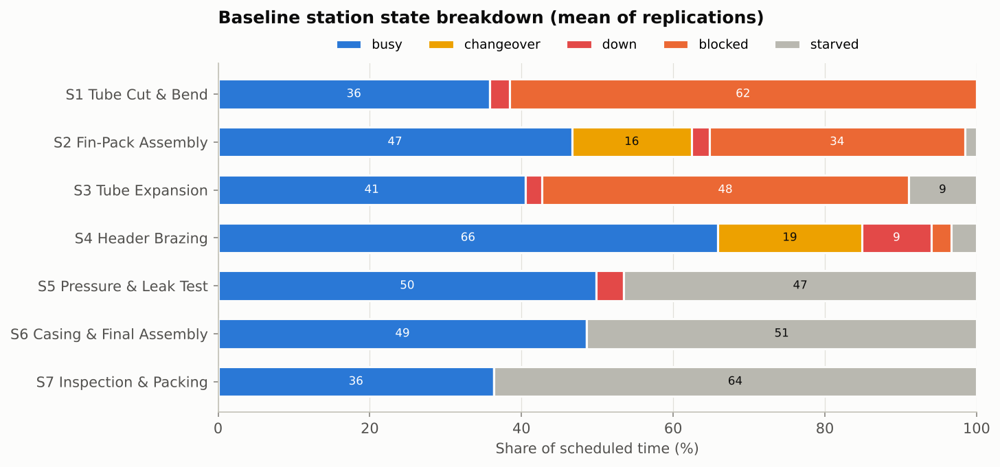
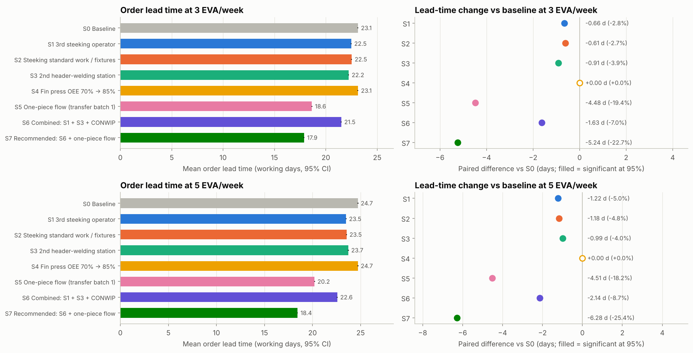
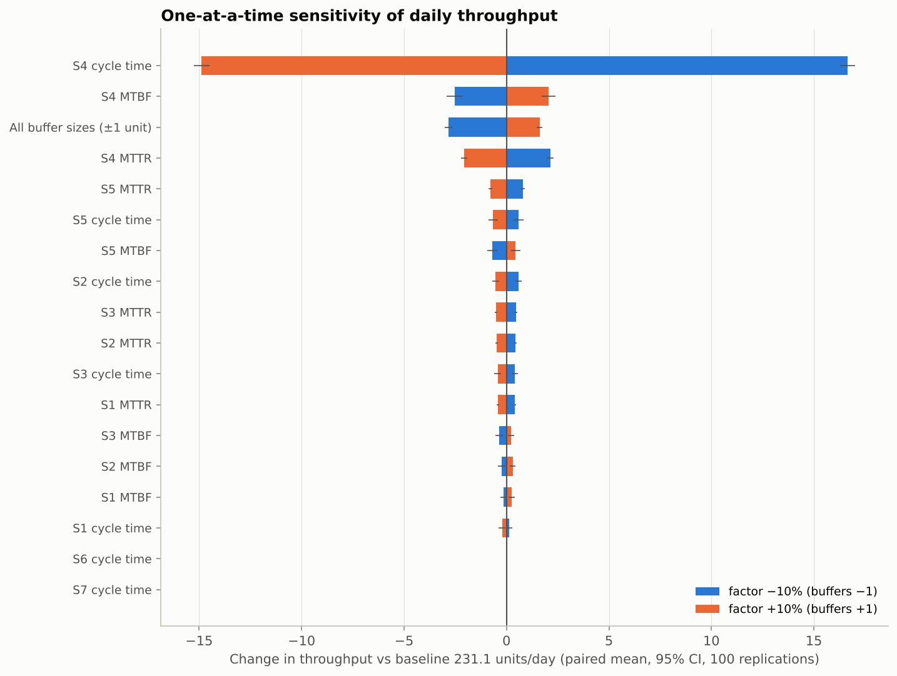
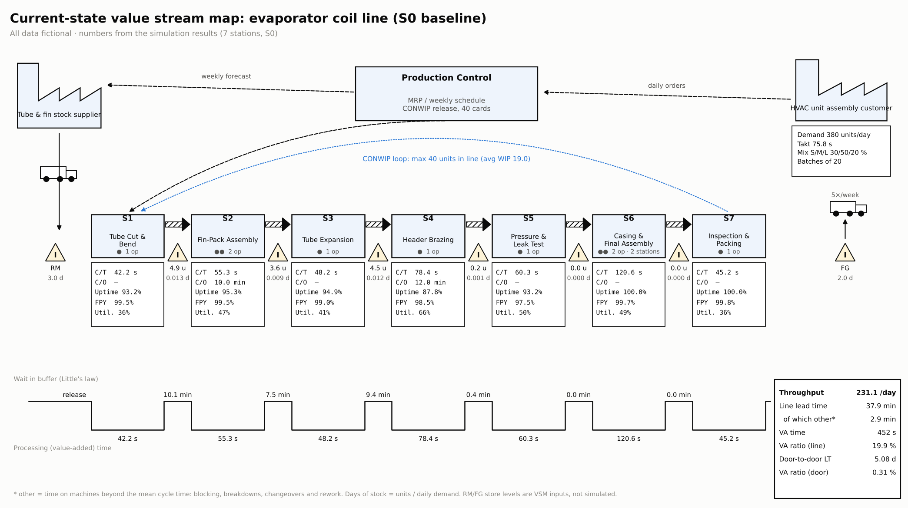
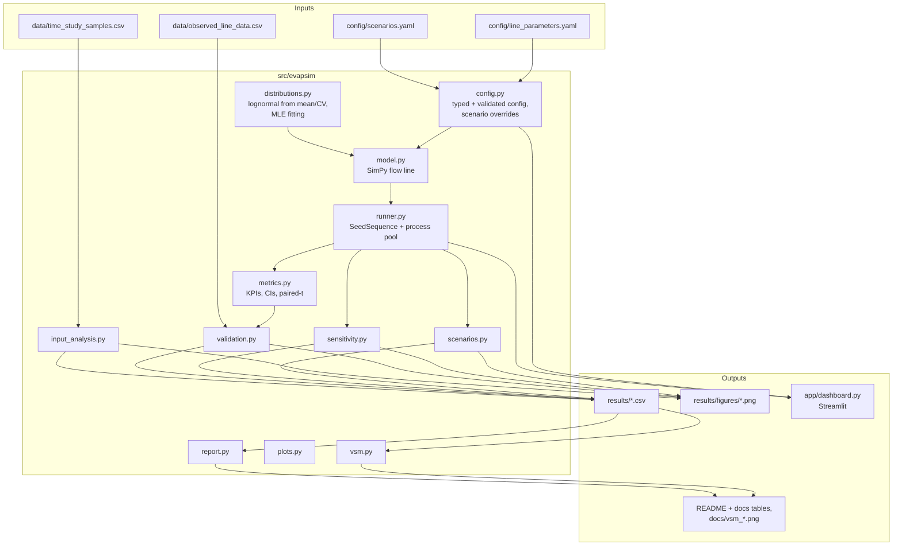
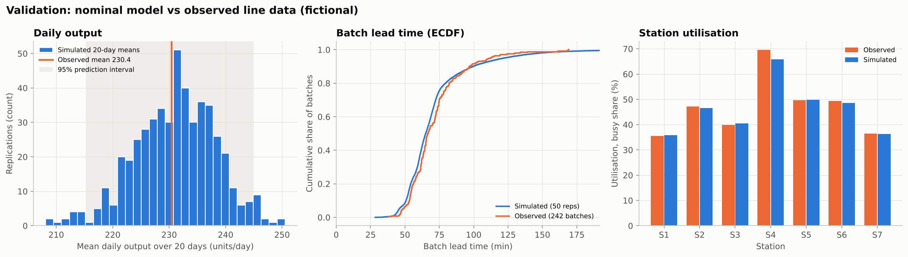
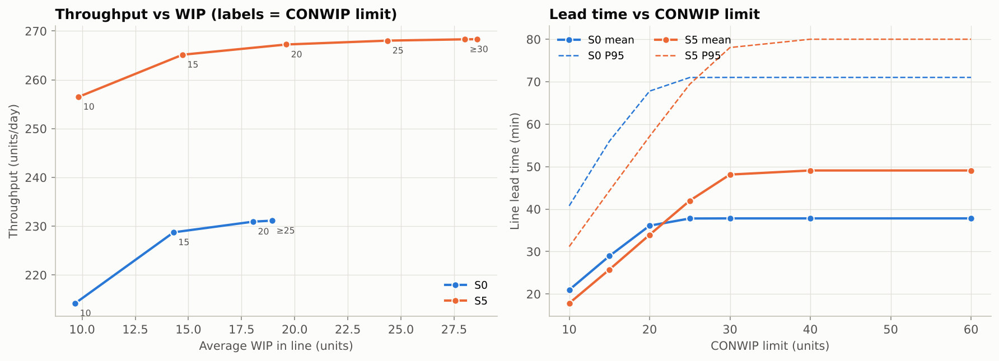
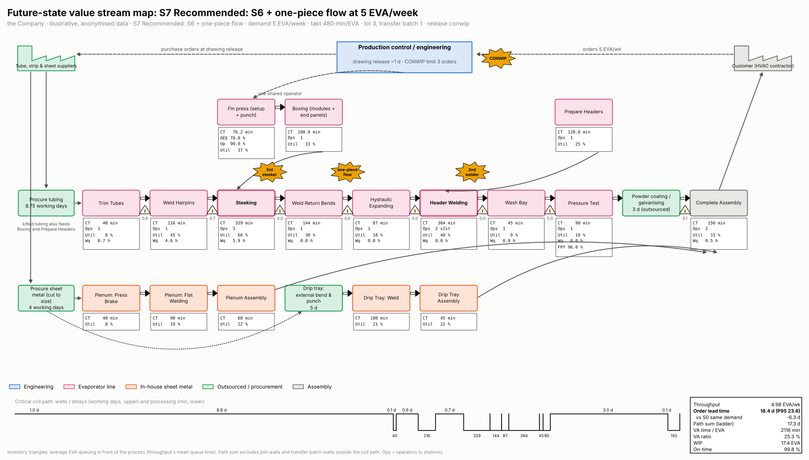

# Discrete-Event Simulation and Monte Carlo Analysis of an Evaporator Coil Assembly Line

**A value stream map (VSM) model of a stochastic flow line: reproduce the line's KPIs, find the bottleneck, and compare improvement scenarios with statistical confidence.**

[](https://github.com/fadeelphillips29-cmd/facility-materials-handling-optimization/actions/workflows/evaporator-line-des-ci.yml)


---

> [!IMPORTANT]
> **Fictional data disclaimer.** The production line, products, parameters,
> time-study samples, "observed" line data and every result in this
> repository are **fictional**. They were designed to be realistic for an
> industrial engineering portfolio project. They do not describe, and are
> not derived from, any real company, plant, product or person.

---

## Contents

1. [Problem statement and objectives](#1-problem-statement-and-objectives)
2. [Key results](#2-key-results)
3. [Line description](#3-line-description)
4. [Model overview](#4-model-overview)
5. [Repository structure](#5-repository-structure)
6. [Installation and quick start](#6-installation-and-quick-start)
7. [How to operate the model](#7-how-to-operate-the-model)
8. [Inputs reference](#8-inputs-reference)
9. [Outputs reference](#9-outputs-reference)
10. [Verification and validation](#10-verification-and-validation)
11. [Scenario results and recommendations](#11-scenario-results-and-recommendations)
12. [Limitations and future work](#12-limitations-and-future-work)
13. [Build phases](#13-build-phases)
14. [Tech stack](#14-tech-stack)
15. [Skills demonstrated](#15-skills-demonstrated)
16. [License and author](#16-license-and-author)

---

## 1. Problem statement and objectives

An evaporator coil assembly line (7 stations, 3 coil sizes, batches of 20) has
to deliver **380 units per 480-minute shift**, a takt time of **75.8 s**. A
static value stream map can show cycle times and inventory, but it cannot
answer the questions management cares about:

* What does the line *really* produce per day once breakdowns, changeovers,
  scrap, rework and blocking between stations interact?
* Which station is the constraint, and how sure are we?
* Which improvement (bigger buffers, SMED, a second brazing fixture,
  preventive maintenance, or a combination) gives the most output, how large
  is the gain, and is it statistically real?

**Objectives**

1. Build a validated discrete-event simulation (DES) of the line, including
   its VSM data (C/T, C/O, uptime, FPY, operators, inventory).
2. Quantify throughput, takt compliance, lead time, WIP, utilisation and
   bottleneck location, each with a 95 % confidence interval, using Monte
   Carlo replication.
3. Validate the model against measured (fictional) line data, aiming for an
   error of 5 % or less.
4. Compare six improvement scenarios using common random numbers and paired
   confidence intervals, and rank the parameters that drive throughput
   (sensitivity analysis).
5. Draw the current-state and future-state VSMs from simulated numbers, and
   provide a dashboard for what-if analysis.

## 2. Key results

All numbers come from the committed runs in `results/` and are inserted into
this README by `make report`.

<!-- BEGIN:headline -->
| KPI | Baseline (S0) | Combined (S5) | S5 + 2nd fixture (S6) |
|---|---|---|---|
| Throughput (good units/day) | 231.1 (±0.6) | 268.2 (±0.6) | 374.7 (±0.7) |
| Demand attainment (demand 380/day) | 60.8 % | 70.6 % | 98.6 % |
| Takt compliance (days ≥ 380) | 0.0 % (±0.0) | 0.0 % (±0.0) | 48.5 % (±0.9) |
| Line lead time, mean (min) | 37.9 (±0.1) | 49.2 (±0.1) | 30.0 (±0.1) |
| Line lead time, P95 (min) | 71.4 (±0.7) | 80.4 (±0.7) | 47.7 (±0.4) |
| WIP (units) | 19.0 (±0.0) | 28.6 (±0.0) | 24.3 (±0.1) |
| Bottleneck (share of replications) | S4 (100 %) | S4 (100 %) | S2 (100 %) |
| Paired throughput gain vs S0 (95 % CI) | - | +37.1 [36.9, 37.4] = +16.1 % | +143.6 [143.0, 144.2] = +62.1 % |

_Mean (± 95 % CI half-width) over 500 replications of 20 measured days each, common random numbers. Source: `results/scenario_summary.csv`, `results/scenario_paired_differences.csv`._
<!-- END:headline -->

**In one paragraph.** The baseline line makes **231 good units/day, 61 % of
demand**, and meets takt on **0 % of days**. **Header Brazing (S4)** is the
bottleneck in every replication. It needs about 112.6 s per unit once
breakdowns (MTBF 180 min, MTTR 25 min) and model changeovers (12 min, on 62 %
of batches) are included, against a takt of 75.8 s. The brief's combined
scenario **S5 (SMED + preventive maintenance + 8-unit buffers) adds
+37.1 units/day (+16.1 %, 95 % CI [36.9, 37.4], p < 0.001)**, but it still
reaches only 71 % of demand. Adding a second brazing fixture on top of S5
(**S6**, an extension beyond the brief) lifts output to **374.7 units/day
(98.6 % of demand)**, and the bottleneck moves to Fin-Pack Assembly (S2).

| Baseline station states | Scenario comparison |
|---|---|
|  |  |



## 3. Line description

Single-piece flow through seven stations. Cycle times are lognormal with the
given mean (Medium model) and CV, multiplied by the model's factor (Small 0.85
/ Medium 1.00 / Large 1.25, with a mix of 30 / 50 / 20 %). Buffers between
stations hold 5 units, and a station that cannot pass its unit on is
**blocked** until space frees up. Release is **CONWIP** with a limit of
40 units.

<!-- BEGIN:stations -->
| # | Station | CT mean (s) | CV | Servers | MTBF / MTTR (min) | C/O (min) | Scrap | Operators | Eff. time/unit (s) | Static capacity (/day) |
|---|---|---|---|---|---|---|---|---|---|---|
| 1 | Tube Cut & Bend | 42 | 0.15 | 1 | 240 / 18 | - | 0.5 % | 1 | 45.4 | 635 |
| 2 | Fin-Pack Assembly | 55 | 0.18 | 1 | 300 / 15 | 10 | 0.5 % | 2 | 76.6 | 376 |
| 3 | Tube Expansion | 48 | 0.12 | 1 | 360 / 20 | - | 1.0 % | 1 | 50.9 | 566 |
| 4 | Header Brazing | 78 | 0.20 | 1 | 180 / 25 | 12 | 1.5 % | 1 | 112.6 | 256 |
| 5 | Pressure & Leak Test | 60 | 0.10 | 1 | 420 / 30 | - | 2.5 % | 1 | 64.6 | 446 |
| 6 | Casing & Final Assembly | 120 | 0.15 | 2 | - | - | 0.3 % | 2 | 60.3 | 478 |
| 7 | Inspection & Packing | 45 | 0.12 | 1 | - | - | 0.2 % | 1 | 45.2 | 637 |

_Takt = 480 × 60 / 380 = 75.8 s. Effective time per unit = CT × mix multiplier (1.005) × (1 + MTTR/MTBF) + P(model switch) (0.62) × C/O ÷ batch size, plus the rework load at S4, divided by the number of servers. Static capacity ignores blocking and starving, so it is an upper bound. Source: `results/static_capacity.csv`._
<!-- END:stations -->

Leak-test failures (2.5 %) are reworked at Header Brazing in 40 % of cases
(+90 s, then re-tested). The rest are scrapped.



## 4. Model overview

### 4.1 Architecture



### 4.2 Entities, resources and events

* **Entities**: units (coils). Each one carries its batch, model, release time,
  pre-drawn random numbers (for common random numbers) and timestamps at every
  station.
* **Resources**: each machine is its own SimPy process with five timed states
  (*busy, starved, blocked, down, changeover*). Buffers are a priority store
  plus a container of slots. CONWIP cards are a container.
* **Events**: release → (changeover) → processing, which failures may
  interrupt → scrap or test decision → hand-over (blocked while the downstream
  buffer is full) → exit. Failed leak tests go back to brazing in a priority
  rework lane that cannot deadlock.

Full conceptual model, machine state diagram and logic flow:
[`docs/MODEL_DESCRIPTION.md`](docs/MODEL_DESCRIPTION.md).

### 4.3 Main assumptions (full list: [`docs/ASSUMPTIONS.md`](docs/ASSUMPTIONS.md))

* The line is **saturated**: raw material is always available, so throughput
  is set by capacity (A2). Only productive time is simulated (A3).
* Failures depend on operation: the failure clock runs only while a machine
  processes (A12). Repair times are exponential.
* A changeover happens when the model changes between batches, and each
  parallel fixture changes over on its own (A13).
* 1 warm-up day + 20 measured days per replication. 500 replications for the
  baseline and each scenario (A4).
* The bottleneck is found with the **active-period method**
  (busy + down + changeover). The brief's literal "busy + blocked" rule picks
  S1, which is *blocked by* the bottleneck (A21).
* All brief parameters were used unchanged. The large takt gap is a property
  of the given data, which the static capacity check confirms (A20).

### 4.4 Why DES with Monte Carlo replication?

Spreadsheet line balancing and a static VSM use averages. Throughput on this
line is lost in the *interactions*: a brazing breakdown fills the upstream
buffers and blocks S1-S3, and a changeover at Fin-Pack starves brazing. Both
depend on how variable and how long each event is, and on how big the buffers
are. DES represents those mechanisms directly. Monte Carlo replication turns
one random day into a distribution, so every KPI comes with a confidence
interval. Common random numbers let scenarios be compared on identical event
sequences, which shrinks the CIs on the differences.

## 5. Repository structure

```text
evaporator-line-des/
├── README.md                       ← this file (tables generated by `make report`)
├── LICENSE · Makefile · requirements.txt · pyproject.toml · .gitignore
├── .github/workflows/ci.yml        ← ruff + pytest + 10-replication smoke run
├── config/
│   ├── line_parameters.yaml        ← every model input
│   └── scenarios.yaml              ← S0-S6 overrides
├── data/
│   ├── time_study_samples.csv      ← 40 stopwatch readings per station (fictional)
│   └── observed_line_data.csv      ← 20 "measured" days, MES-style long format (fictional)
├── src/evapsim/
│   ├── config.py · distributions.py · model.py · metrics.py · runner.py
│   ├── scenarios.py · validation.py · sensitivity.py · vsm.py · plots.py
│   ├── input_analysis.py · datagen.py · pipeline.py · report.py · __main__.py (CLI)
├── app/dashboard.py                ← Streamlit what-if dashboard
├── notebooks/analysis.ipynb        ← executed walkthrough (outputs saved)
├── results/                        ← CSV tables (+ figures/*.png)
├── docs/
│   ├── OPERATING_PROCEDURES.md · BUILD_PHASES.md · ASSUMPTIONS.md · MODEL_DESCRIPTION.md
│   └── vsm_current.png · vsm_future.png
└── tests/                          ← verification and regression tests (pytest)
```

## 6. Installation and quick start

```bash
git clone https://github.com/fadeelphillips29-cmd/facility-materials-handling-optimization.git
cd facility-materials-handling-optimization/evaporator-line-des
python -m venv .venv && source .venv/bin/activate      # Windows: .venv\Scripts\activate
make setup                    # install requirements and the evapsim package
make test                     # ruff-clean code, pytest verification suite
make quick                    # whole pipeline with 50 replications -> results/quick/  (~5 min)
make all                      # full pipeline, 500 replications (~22 min on 4 cores)
make dashboard                # http://localhost:8501
```

Without `make`, run the steps directly: `python -m evapsim baseline`,
`python -m evapsim scenarios`, and so on (`python -m evapsim --help`).

## 7. How to operate the model

The full step-by-step SOP, with pre-run and sign-off checklists, is in
[`docs/OPERATING_PROCEDURES.md`](docs/OPERATING_PROCEDURES.md). In short:

| Task | Command / action | Output |
|---|---|---|
| Run the baseline (input analysis, Monte Carlo, convergence, validation) | `make baseline` (`QUICK=1` for 50 reps) | `results/baseline_*.csv`, `convergence*.csv`, `validation_*.csv`, figures |
| Run all scenarios, sensitivity, CONWIP sweep and VSMs | `make scenarios` | `results/scenario_*.csv`, `sensitivity_oat.csv`, `conwip_sweep.csv`, `docs/vsm_*.png` |
| Change an input | Edit `config/line_parameters.yaml`, then `make test baseline` | Re-validated config. Invalid values are rejected with a clear message |
| Add a scenario | Add a block to `config/scenarios.yaml` (`extends`, `{scale: }`, `{add: }`, station ranges) | It is picked up by `make scenarios` automatically |
| Explore interactively | `make dashboard`, pick a scenario, edit parameters, press **Run** | KPI tiles with paired deltas against S0, charts |
| Refresh documentation numbers | `make report` | README and docs tables regenerated from the CSV files |
| Verification mode | `simulation.deterministic: true`, `breakdowns: false` | Zero-variance run to compare with hand calculations |

Every run is seeded (`simulation.base_seed`). The same inputs give
bit-for-bit identical results for any number of worker processes.

## 8. Inputs reference

All inputs are in `config/line_parameters.yaml`. The loader (`config.py`)
rejects values outside the ranges below.

| Field | Unit | Valid range | Meaning |
|---|---|---|---|
| `meta.line_name`, `meta.data_status`, `meta.config_version` | text | any | Labels and semantic version of the parameter set |
| `shift.shifts_per_day` | shifts | ≥ 1 | Shifts per day |
| `shift.net_productive_minutes` | min/shift | > 0 | Available time after breaks. Takt = available time / demand |
| `demand.units_per_day` | units/day | > 0 | Customer demand. Used for takt, takt compliance and days of stock |
| `orders.batch_size` | units | ≥ 1 | Units per released batch (all the same model) |
| `products[].name` | text | unique | Product model |
| `products[].mix` | fraction | 0-1, sum = 1 | Probability that a batch is this model |
| `products[].ct_multiplier` | × | > 0 | Cycle-time factor relative to the Medium model |
| `release.rule` | - | `conwip` \| `unlimited` | Release rule at Station 1 |
| `release.conwip_limit` | units | ≥ 1 | Maximum units in the line (CONWIP only) |
| `buffers.capacities[]` | units | ≥ 1, *N - 1* entries | Buffer after station *i* (blocking after service) |
| `stations[].id` | - | 1..N in order | Routing order |
| `stations[].name` | text | - | Station name |
| `stations[].ct_mean_s` | s | > 0 | Mean cycle time (Medium model) |
| `stations[].ct_cv` | - | 0-2 | CV of the lognormal cycle time (0 = deterministic) |
| `stations[].servers` | machines | ≥ 1 | Identical parallel machines or workstations sharing one input buffer |
| `stations[].mtbf_min` | min of operation | > 0 or `null` | Mean operating time between failures (exponential) |
| `stations[].mttr_min` | min | > 0 or `null` | Mean time to repair (exponential). Give both or neither |
| `stations[].scrap_rate` | fraction | 0 ≤ p < 1 | Scrap probability per unit. At the test station: failure probability |
| `stations[].changeover` | bool | - | Whether a model switch triggers a changeover |
| `stations[].changeover_min` | min | ≥ 0 | Mean changeover duration |
| `stations[].vsm.operators` | people | ≥ 0 | Operators shown on the VSM |
| `stations[].vsm.value_added_time_s` | s | ≥ 0 | Observed VA time (gemba-walk snapshot) |
| `stations[].vsm.inventory_in_front_units` | units | ≥ 0 | Observed inventory snapshot (validation only) |
| `stations[].vsm.uptime_pct`, `first_pass_yield_pct` | % | 0-100 | Observed snapshot (validation only) |
| `rework.test_station` | id | station id | Station whose failures may be reworked |
| `rework.rework_station` | id | 2 ≤ id < test | Station that performs rework |
| `rework.rework_share` | fraction | 0-1 | Share of test failures reworked (the rest are scrapped) |
| `rework.rework_time_s`, `rework_cv` | s, - | > 0, ≥ 0 | Lognormal rework time |
| `rework.max_reworks_per_unit` | count | ≥ 0 | A unit that fails again after this many reworks is scrapped |
| `simulation.days` | days | ≥ 1 | Measured days per replication |
| `simulation.warmup_days` | days | ≥ 0 | Discarded initial days |
| `simulation.replications` | count | ≥ 2 | Full-mode replications |
| `simulation.quick_replications` | count | ≥ 2 | Quick-mode replications |
| `simulation.sensitivity_replications` | count | ≥ 2 | Replications per sensitivity or CONWIP-sweep run |
| `simulation.base_seed` | int | any | Root of all random streams |
| `simulation.changeover_cv` | - | ≥ 0 | CV of changeover durations |
| `simulation.deterministic` | bool | - | `true` sets every CV to 0 (verification) |
| `simulation.breakdowns` | bool | - | `false` disables all failures (verification) |
| `vsm.raw_material_stock_days`, `finished_goods_stock_days` | days | ≥ 0 | Store levels outside the simulated boundary (VSM door-to-door lead time) |
| `vsm.supplier`, `vsm.customer`, `vsm.shipments_per_week` | text, count | - | VSM labels |

`config/scenarios.yaml`: each scenario has `name`, `description`, an optional
`extends: [ids]` and `overrides` (same structure as above). Values can be
literals, `{scale: x}` or `{add: x}`. Station keys can be an id, `"a-b"` or
`"all"`. `buffers: {all: N}` sets every buffer.

## 9. Outputs reference

All metrics are measured after warm-up. The reported value is the mean over
replications with a Student-t 95 % CI (*x̄ ± t₀.₉₇₅,ₙ₋₁ · s/√n*).

| Metric (column) | Definition / formula |
|---|---|
| `throughput_per_day` | Good units leaving S7 / measured days |
| `attainment` | Throughput / demand |
| `takt_compliance` | Share of measured days with output ≥ demand |
| `lt_mean_min`, `lt_p50/p90/p95_min` | Line lead time of each good unit = exit time - release time (productive minutes). Mean and percentiles per replication |
| `batch_lt_mean_min` | Last departure of a batch - first release of that batch |
| `wip_avg` | Time-average number of units released and not yet departed: (1/T)∫WIP(t)dt |
| `littles_wip` | λ·W = (departures per minute) × (mean time in system). Verifies `wip_avg` |
| `fpy_line` | Units that passed every station first time / units departed |
| `rty` | ∏ station FPY (rolled throughput yield) |
| `scrap_share` | Units scrapped / units departed |
| `va_time_s` | Sum of processing times of a good unit (VSM value-added time) |
| `va_ratio_line` | Mean VA time / mean line lead time |
| `va_ratio_door` | VA time / (line lead time + RM and FG store days × 480 min) |
| `busy`, `starved`, `blocked`, `down`, `changeover` | Time in state / (servers × measured time). The five sum to 1 |
| `active` | busy + down + changeover (= 1 - starved - blocked) |
| `bottleneck_station` | argmax over stations of `active` in each replication (active-period method) |
| `bottleneck_busy_blocked_rule` | argmax of busy + blocked (the brief's literal rule, kept for comparison) |
| `uptime` | busy / (busy + down). Estimates MTBF / (MTBF + MTTR) |
| `fpy` (station) | 1 - scrapped (or failed the test) / units completed first pass |
| `buffer_in_front_avg`, `days_of_stock_in_front` | Time-average buffer content, and that content / daily demand |
| `diff_mean`, `diff_ci_low/high` | Paired difference (scenario - S0) per replication, with a 95 % t-interval |
| `p_value`, `significant` | Paired t-test p-value. Significant = the CI excludes 0 |
| `crn_corr` | Correlation between the S0 and scenario replication values (CRN effectiveness) |
| `elasticity` | (% change in throughput) / (% change in factor) |
| `t_eff_s`, `capacity_per_day` (static) | CT × 1.005 × (1 + MTTR/MTBF) + 0.62 × C/O / batch (+ rework) ÷ servers, and 28 800 / t_eff |

## 10. Verification and validation

**Verification** (`tests/`, run in CI) covers:
- Deterministic mode reproduces the hand-calculated throughput
  1 / max(CTᵢ/serversᵢ) = 28 800 / 78 = 369.2 units/day.
- With two brazing fixtures, the deterministic bottleneck moves to S6
  (60 s/unit).
- An exact changeover-time balance in a two-model case.
- **Little's law**: WIP = TH × LT. Across the baseline the two estimates
  agree to within 0.01 %.
- **Conservation of units** (released = departed + in line).
- The CONWIP cap is never exceeded, and timestamps follow the routing order.
- No deadlock in the rework loop under stress.
- Smaller buffers cause more blocking.
- Reproducibility under the same seed, parallel runs equal serial runs, and
  common random numbers give a positive correlation.

The static capacity bound (255.7 units/day at S4) is above the simulated
231.1 units/day, as it must be. The difference is the cost of blocking and
starving.

**Convergence**: about 40 replications give a ±1 % CI on throughput. The
500-replication run gives ±0.27 %.

<!-- BEGIN:convergence -->
| Metric | Target CI half-width | Replications required | Achieved with run |
|---|---|---|---|
| throughput_per_day | ±0.5 % | 152 | ±0.27 % (500 reps) |
| throughput_per_day | ±1 % | 40 | ±0.27 % (500 reps) |
| throughput_per_day | ±2 % | 12 | ±0.27 % (500 reps) |
| lt_mean_min | ±0.5 % | 175 | ±0.29 % (500 reps) |
| lt_mean_min | ±1 % | 46 | ±0.29 % (500 reps) |
| lt_mean_min | ±2 % | 14 | ±0.29 % (500 reps) |
<!-- END:convergence -->

**Validation** of the nominal model against 20 days of observed (fictional)
line data, which came from a *perturbed* copy of the line:

<!-- BEGIN:validation -->
| Measure | Observed | Simulated | Error | Sim. 95 % PI | PI p-value | Welch p | Verdict |
|---|---|---|---|---|---|---|---|
| Mean daily output (units/day) | 230.4 | 231.1 | +0.30 % | [215.2, 245.0] | 0.87 | 0.86 | valid |
| Mean batch lead time (min) | 72.0 | 71.4 | -0.91 % | [67.5, 76.8] | 0.69 | 0.62 | valid |
| Station utilisation (7 stations) | - | - | mean abs. 0.89 pp; worst S4 -5.2 % | - | - | - | valid |
<!-- END:validation -->

Both headline measures are well inside the 5 % target and the 95 % prediction
intervals, so no calibration was needed. The station-level check still finds
the biggest hidden discrepancy: brazing is 4.7 % slower in the "real" line,
and S4 shows the largest utilisation error. See BUILD_PHASES, Phase 6.



## 11. Scenario results and recommendations

<!-- BEGIN:scenario_defs -->
| ID | Scenario | Change |
|---|---|---|
| S0 | Baseline | Current state as described in line_parameters.yaml. |
| S1 | Larger buffers | All inter-station buffers increased from 5 to 10 units. |
| S2 | SMED | Changeover times reduced by 40% at Fin-Pack (St 2) and Header Brazing (St 4). |
| S3 | Second brazing fixture | Header Brazing (St 4) capacity increased to 2 parallel fixtures. |
| S4 | Preventive maintenance | TPM programme: MTBF +25% and MTTR -15% at stations 1-5. |
| S5 | Combined (SMED + PM + buffers 8) | S2 and S4 together, with all buffers set to 8 units. |
| S6 | Combined + second fixture (extension) | S5 plus a second brazing fixture (S3). Added beyond the brief to test whether takt is reachable. |
<!-- END:scenario_defs -->

<!-- BEGIN:scenarios -->
| Scenario | TH (units/day) | ΔTH vs S0 [95 % CI] | ΔTH % | p (paired t) | Takt compliance | LT mean (min) | ΔLT vs S0 [95 % CI] | WIP | Bottleneck |
|---|---|---|---|---|---|---|---|---|---|
| **S0** Baseline | 231.1 | - | - | - | 0.0 % | 37.9 | - | 19.0 | S4 (100 %) |
| **S1** Larger buffers | 237.0 | +5.9 [5.8, 6.1] | +2.6 % | < 0.001 | 0.0 % | 65.8 | +27.9 [27.8, 28.0] | 33.8 | S4 (100 %) |
| **S2** SMED | 250.5 | +19.4 [19.2, 19.6] | +8.4 % | < 0.001 | 0.0 % | 36.3 | -1.6 [-1.6, -1.6] | 19.7 | S4 (100 %) |
| **S3** Second brazing fixture | 302.6 | +71.5 [70.9, 72.0] | +30.9 % | < 0.001 | 0.6 % | 29.8 | -8.1 [-8.1, -8.0] | 19.5 | S2 (100 %) |
| **S4** Preventive maintenance | 243.4 | +12.3 [12.1, 12.6] | +5.3 % | < 0.001 | 0.0 % | 36.3 | -1.6 [-1.6, -1.5] | 19.1 | S4 (100 %) |
| **S5** Combined (SMED + PM + buffers 8) | 268.2 | +37.1 [36.9, 37.4] | +16.1 % | < 0.001 | 0.0 % | 49.2 | +11.3 [11.3, 11.4] | 28.6 | S4 (100 %) |
| **S6** Combined + second fixture (extension) | 374.7 | +143.6 [143.0, 144.2] | +62.1 % | < 0.001 | 48.5 % | 30.0 | -7.8 [-7.9, -7.7] | 24.3 | S2 (100 %) |
<!-- END:scenarios -->

_500 replications per scenario with common random numbers. Brackets show the
95 % CI of the paired difference against S0._

**Sensitivity (one factor at a time, 100 paired replications per run):**

<!-- BEGIN:sensitivity -->
| Factor | −10 % (buffers −1) | +10 % (buffers +1) | Elasticity (+) |
|---|---|---|---|
| S4 cycle time | +16.6 [16.3, 17.0] | -14.9 [-15.3, -14.5] | -0.64 |
| S4 MTBF | -2.5 [-2.9, -2.1] | +2.1 [1.7, 2.4] | +0.09 |
| All buffer sizes (±1 unit) | -2.8 [-3.0, -2.7] | +1.6 [1.5, 1.7] | +0.03 |
| S4 MTTR | +2.1 [2.0, 2.3] | -2.1 [-2.2, -1.9] | -0.09 |
| S5 MTTR | +0.8 [0.7, 0.9] | -0.8 [-0.9, -0.7] | -0.03 |
| S5 cycle time | +0.6 [0.4, 0.8] | -0.7 [-0.9, -0.4] | -0.03 |
| S5 MTBF | -0.7 [-0.9, -0.5] | +0.5 [0.2, 0.7] | +0.02 |
| S2 cycle time | +0.6 [0.4, 0.7] | -0.5 [-0.7, -0.4] | -0.02 |

_Change in throughput (units/day) against the baseline, as a paired mean with its 95 % CI. Factors are ranked by swing. Source: `results/sensitivity_oat.csv`._
<!-- END:sensitivity -->

### Engineering interpretation

1. **The constraint is Header Brazing (S4), with certainty.** S4 is the
   bottleneck in 100 % of baseline replications, and its machine is active
   (busy, down or changing over) 94 % of the time. 19 % of that time is
   changeovers and 9 % is breakdowns. The tornado chart shows that S4's cycle
   time is the only factor with a large effect. Changing any other station's
   parameters by ±10 %, or all buffers by ±1 unit, moves throughput by at
   most 1.2 %. *Improvement
   effort away from S4 is wasted until S4 is relieved* (Theory of
   Constraints).
2. **SMED and TPM work but are not enough.** On their own they add
   +19.4 units/day (SMED, +8.4 %) and +12.3 units/day (PM, +5.3 %). Combined
   with 8-unit buffers (S5) they add **+37.1 units/day (+16.1 %, CI
   [36.9, 37.4])**. That is 5.4 units/day more than SMED and PM add up to on
   their own; the extra comes from the larger buffers and how they interact
   with the other two changes. Output is still only **71 % of
   demand**. Expected gain: high confidence (p < 0.001, CRN correlation 0.93).
3. **Do not buy buffer space to fix flow under CONWIP.** Bigger buffers alone
   (S1) add only +2.6 % throughput but increase lead time by +74 % (+27.9 min),
   because the extra slots fill up with WIP. The same mechanism makes S5's lead
   time 30 % *longer* than the baseline's (more WIP in larger buffers). The
   CONWIP sweep shows the WIP-throughput trade-off. In S5, a CONWIP limit of
   20 instead of 40 keeps throughput within 0.5 % and cuts mean lead time by
   about 30 %. In the baseline the limit of 40 never binds: average WIP is
   only about 19 units, because the buffers after the bottleneck stay almost
   empty.

<!-- BEGIN:conwip -->
| Scenario | CONWIP limit | TH (units/day) | ΔTH vs limit 40 [95 % CI] | WIP | LT mean (min) | LT P95 (min) |
|---|---|---|---|---|---|---|
| S0 | 10 | 214.2 | -16.9 [-17.4, -16.5] | 9.7 | 21.0 | 40.8 |
| S0 | 15 | 228.7 | -2.4 [-2.6, -2.2] | 14.3 | 28.9 | 56.0 |
| S0 | 20 | 230.9 | -0.2 [-0.2, -0.2] | 18.1 | 36.1 | 67.8 |
| S0 | 25 | 231.1 | -0.0 [-0.0, 0.0] | 18.9 | 37.8 | 71.0 |
| S0 | 30 | 231.1 | +0.0 [0.0, 0.0] | 18.9 | 37.8 | 71.0 |
| S0 | **40** | 231.1 | - | 18.9 | 37.8 | 71.0 |
| S0 | 60 | 231.1 | +0.0 [0.0, 0.0] | 18.9 | 37.8 | 71.0 |
| S5 | 10 | 256.5 | -11.8 [-12.2, -11.4] | 9.8 | 17.8 | 31.2 |
| S5 | 15 | 265.1 | -3.2 [-3.4, -2.9] | 14.7 | 25.8 | 44.3 |
| S5 | 20 | 267.2 | -1.1 [-1.2, -0.9] | 19.6 | 33.9 | 57.1 |
| S5 | 25 | 268.0 | -0.3 [-0.3, -0.2] | 24.4 | 42.0 | 69.4 |
| S5 | 30 | 268.3 | -0.0 [-0.0, -0.0] | 28.0 | 48.1 | 78.0 |
| S5 | **40** | 268.3 | - | 28.6 | 49.1 | 80.0 |
| S5 | 60 | 268.3 | +0.0 [0.0, 0.0] | 28.6 | 49.1 | 80.0 |

_Paired against the scenario at its configured limit (bold), 100 replications per point. Source: `results/conwip_sweep.csv`, figure `results/figures/conwip_sweep.png`._
<!-- END:conwip -->



4. **Capacity at S4 is the decisive lever.** A second brazing fixture (S3)
   is the largest single gain (+71.5 units/day, +30.9 %), and the bottleneck
   moves to Fin-Pack (S2), whose changeovers now take 21 % of its time. Only
   the combination **S6 = S5 + second fixture** gets close to takt: **374.7
   units/day (98.6 % of demand)**. Takt is met on 48.5 % of days.
5. **Recommended roadmap.** (a) Start SMED at S4 *and* S2 together, because S2
   becomes the constraint as soon as S4 improves. (b) Start TPM at S4, which
   has the worst MTBF. (c) Build the case for the second brazing fixture,
   using S6 as the target state. (d) Close the remaining 1.4 % gap by
   sequencing same-model batches together (fewer changeovers) or with about
   7 minutes of planned overtime per day (380 / 374.7 - 1 = 1.4 % of 480 min).
   Keep buffers at 5 and lower the CONWIP limit so lead time stays short.



<!-- BEGIN:vsm_summary -->
| VSM measure | Current (S0) | Future (S5) |
|---|---|---|
| Throughput (units/day) | 231.1 | 268.2 |
| Line lead time (min) | 37.9 | 49.2 |
| Value-added time per unit (s) | 452 | 452 |
| VA ratio, line (%) | 19.9 | 15.3 |
| Door-to-door lead time (days) | 5.08 | 5.10 |
| VA ratio, door-to-door (%) | 0.31 | 0.31 |
| Line WIP (units) | 19.0 | 28.6 |
<!-- END:vsm_summary -->

## 12. Limitations and future work

**Limitations**
- **All data is fictional.** The conclusions show the method, not a real
  plant.
- One shift with productive time only. Shift start-up losses, absenteeism and
  breaks that do not line up across stations are not modelled.
- Operators are not a constrained resource. The second fixture (S3/S6) is
  assumed to be staffed.
- Breakdowns are exponential and do not depend on machine age. Repairs are
  never delayed by a shortage of maintenance technicians.
- Batch models are drawn at random. A real scheduler would sequence them to
  reduce changeovers.
- The line is saturated. A demand-driven arrival process with finished-goods
  stock is not modelled.
- VA time counts all processing (conventional VSM practice). It does not
  separate necessary non-value-added work such as testing and inspection.
- One-at-a-time sensitivity does not capture interactions between factors.

**Future work**
- Full or fractional factorial DOE (for example a 2^k design on S4 C/T,
  C/O, MTBF and buffer size) to estimate interactions, plus a response-surface
  model.
- Simulation-based optimisation of buffer allocation and CONWIP limit for a
  given throughput target.
- A scheduling scenario: same-model batch sequencing (heijunka versus
  campaign) and its effect on changeovers.
- Operator resources and multi-skilling, and a two-shift or overtime policy.
- Replace the fictional data with real MES data and re-validate, following
  SOP §9.

## 13. Build phases

The full log, including the real problems hit and how they were solved, is in
[`docs/BUILD_PHASES.md`](docs/BUILD_PHASES.md). Each phase is one git commit.

| Phase | Objective | Main outputs | Key decisions |
|---|---|---|---|
| 1. Problem definition and data design | Define the system and encode the fictional line | `config/*.yaml`, `time_study_samples.csv`, ASSUMPTIONS | Saturated line with CONWIP. Productive time only. Override language for scenarios |
| 2. Input analysis | Choose and justify the cycle-time distributions | `input_analysis.csv`, Q-Q and histogram figures | Lognormal at every station (ΔAIC < 1 against the best alternative, KS p > 0.05) |
| 3. Core model | SimPy line with every mechanism, fully instrumented | `model.py`, `observed_line_data.csv` | One process per machine. Priority rework lane (deadlock-free). Per-unit CRN draws |
| 4. Metrics | KPIs, CIs, paired tests | `metrics.py` | Active-period bottleneck rule instead of the literal "busy + blocked" |
| 5. Monte Carlo runner | Reproducible parallel replications, convergence | `runner.py`, `convergence.png` | SeedSequence spawn keys per replication. 500 replications (40 are enough for ±1 %) |
| 6. Verification and validation | Prove the model is built right and is the right model | `tests/`, `validation_*.csv` | Hand-calculated deterministic checks, Little's law. Error +0.3 % / -0.9 %, no calibration |
| 7. Scenarios and sensitivity | Quantify improvements and rank the levers | `scenario_*.csv`, `sensitivity_oat.csv`, tornado | CRN with paired-t. Added S6. Buffers ±1 unit |
| 8. VSM visualisation | Current and future-state maps from simulated numbers | `docs/vsm_*.png` | Ladder from Little's law with explicit "other delays" |
| 9. Dashboard | Interactive what-if analysis | `app/dashboard.py` | Paired comparison against S0, cached runs, AppTest smoke tests |
| 10. Documentation and polish | Reproducible, consistent deliverable | README, docs, notebook, CI | Every results table generated from the CSV files (`make report`) |

## 14. Tech stack

Python 3.11+ · **SimPy** (discrete-event engine) · **NumPy** (`SeedSequence`,
PCG64 streams) · **pandas** · **SciPy** (MLE fitting, KS, t-tests) ·
**matplotlib** (figures and VSM drawing) · **Streamlit** (dashboard) ·
**PyYAML** · **pytest** · **ruff** · Jupyter / nbconvert · GitHub Actions ·
`concurrent.futures` process pool.

## 15. Skills demonstrated

| Industrial engineering concept | Where it is used |
|---|---|
| **Value stream mapping** (current and future state, VA ratio, lead-time ladder) | `vsm.py`, `docs/vsm_*.png` |
| **Takt time** and demand attainment | Config, KPIs, takt compliance |
| **Bottleneck analysis / Theory of Constraints** (active-period method, bottleneck shift) | `metrics.py`, scenarios S3/S6 |
| **SMED** (changeover reduction) | Scenario S2, sensitivity |
| **TPM / preventive maintenance** (MTBF and MTTR, uptime) | Scenario S4, sensitivity |
| **CONWIP** pull release and the WIP cap | Model release logic, CONWIP sweep |
| **Little's law** (WIP = TH × LT) | Verification test, VSM ladder |
| **Buffer sizing** and blocking in serial lines | Scenario S1, tests, sensitivity |
| **Quality: FPY, RTY, scrap and rework loops** | Model, metrics |
| **Time study and input modelling** (distribution fitting, AIC, KS, Q-Q) | Phase 2 |
| **DOE and sensitivity analysis** (OAT, tornado, elasticity) | `sensitivity.py` |
| **Simulation statistics** (warm-up, replications, CIs, CRN, paired-t, convergence) | `runner.py`, `scenarios.py` |
| **Verification and validation** (hand calculations, prediction intervals, error targets) | `tests/`, `validation.py` |
| **Static capacity analysis** (effective process time, utilisation) | `pipeline.static_capacity` |
| Software practice: typed, tested, reproducible Python, CI, documentation | whole repository |

## 16. License and author

Released under the [MIT License](LICENSE).

**Author:** _[Your Name]_ · _[LinkedIn URL]_ · _[email]_

_Fictional-data project built for an industrial engineering portfolio._
