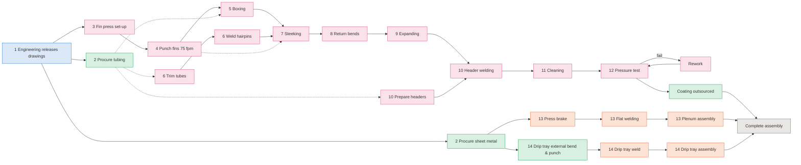

# Discrete-Event Simulation and Monte Carlo Analysis of an Evaporator Production System

> Data are **illustrative and anonymised**. The organisation is called "the Company".

Work in progress (Phase 1). Process map:

Hand-calculated VSM table:

<!-- BEGIN:hand_calc -->
| Step | Process | Dept | Source | Min/EVA | Min/3 EVA | Ops | Labour min/EVA | EVA/shift | EVA/week | Resource util. @ demand |
|---|---|---|---|---|---|---|---|---|---|---|
| 1 | Engineering drawing release | engineering | assumed | - | 1 d | - | - | - | - | - |
| 2 | Procure sheet metal (cut to size) | outsourced | assumed | - | 4 d | - | - | - | - | - |
| 2 | Procure tubing | outsourced | assumed | - | 8.75 d | - | - | - | - | - |
| 3 | Fin Press (setup + punching) | evaporator | time study | 76.2 | 228.6 | 1 | 76.2 | 6.30 | 31.50 | 22.0 % |
| 5 | Boxing (modules + end panels) | evaporator | assumed | 100.0 | 300.0 | 1 | 100.0 | 4.80 | 24.00 | 22.0 % |
| 6 | Trim Tubes | evaporator | assumed | 40.0 | 120.0 | 1 | 40.0 | 12.00 | 60.00 | 5.0 % |
| 6 | Weld Hairpins | evaporator | time study | 216.0 | 648.0 | 1 | 216.0 | 2.22 | 11.11 | 27.0 % |
| 7 | Steeking | evaporator | estimate | 420.0 | 1,260.0 | 2 | 840.0 | 1.14 | 5.71 | 52.5 % **(BN)** |
| 8 | Weld Return Bends | evaporator | time study | 144.0 | 432.0 | 1 | 144.0 | 3.33 | 16.67 | 18.0 % |
| 9 | Hydraulic Expanding | evaporator | time study | 87.0 | 261.0 | 1 | 87.0 | 5.52 | 27.59 | 10.9 % |
| 10 | Prepare Headers | evaporator | assumed | 120.0 | 360.0 | 1 | 120.0 | 4.00 | 20.00 | 15.0 % |
| 10 | Header Welding | evaporator | time study | 384.0 | 1,152.0 | 1 | 384.0 | 1.25 | 6.25 | 48.0 % |
| 11 | Wash Bay | evaporator | assumed | 45.0 | 135.0 | 1 | 45.0 | 10.67 | 53.33 | 5.6 % |
| 12 | Pressure Test | evaporator | assumed | 90.0 | 270.0 | 1 | 90.0 | 5.33 | 26.67 | 11.2 % |
| 13 | Plenum: Press Brake | sheet_metal | assumed | 40.0 | 120.0 | 1 | 40.0 | 12.00 | 60.00 | 5.0 % |
| 13 | Plenum: Flat Welding | sheet_metal | assumed | 90.0 | 270.0 | 1 | 90.0 | 5.33 | 26.67 | 11.2 % |
| 13 | Plenum Assembly | sheet_metal | assumed | 60.0 | 180.0 | 1 | 60.0 | 8.00 | 40.00 | 13.1 % |
| 14 | Drip tray: external bend & punch | outsourced | assumed | - | 5 d | - | - | - | - | - |
| 14 | Drip Tray: Weld | sheet_metal | assumed | 100.0 | 300.0 | 1 | 100.0 | 4.80 | 24.00 | 12.5 % |
| 14 | Drip Tray Assembly | sheet_metal | assumed | 45.0 | 135.0 | 1 | 45.0 | 10.67 | 53.33 | 13.1 % |
| 15 | Powder coating / galvanising | outsourced | assumed | - | 3 d | - | - | - | - | - |
| 15 | Complete Assembly | assembly | assumed | 150.0 | 450.0 | 2 | 300.0 | 3.20 | 16.00 | 18.8 % |
<!-- END:hand_calc -->
