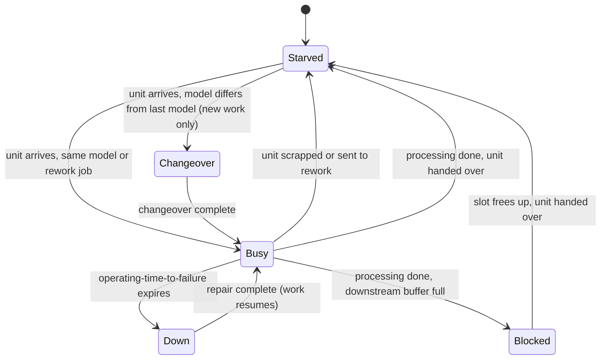
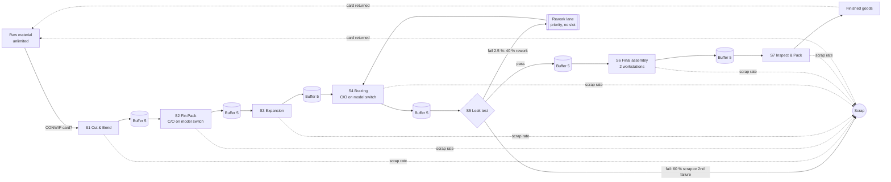

# Model description

> All data is fictional. See `ASSUMPTIONS.md` for every modelling decision
> (referenced below as A1, A2, ...).

## 1. Conceptual model

The line is modelled as a **stochastic serial flow line** with seven stations,
finite inter-station buffers, blocking after service, unreliable machines,
model-dependent changeovers, scrap and a rework loop. Material is released
under a CONWIP rule.

### 1.1 Entities

| Entity | Attributes | Created | Destroyed |
|---|---|---|---|
| **Unit** (one evaporator coil) | id, batch id, product model (Small/Medium/Large), release time, 8 pre-drawn standard normals (7 cycle times + rework time), 9 pre-drawn uniforms (7 scrap decisions + rework decision + re-test), accumulated processing time, rework count, failed-test flag, start/end timestamp at every station | when Station 1 pulls work and a CONWIP card is free | on exit from Station 7 (good) or when scrapped |
| **Batch** | id, model, units released, units departed, first release, last departure | when the first unit of the next 20 is released | never (kept for batch lead time) |

### 1.2 Resources

| Resource | Capacity | Notes |
|---|---|---|
| Machines / workstations | `servers` per station (S6 = 2, S4 = 2 in S3/S6) | each machine is its own SimPy process, so its state is timed exactly |
| Buffer slots | `buffers.capacities[i]` between station *i+1* and *i+2* | a SimPy `Container` of slots. An upstream machine waits for a slot (*blocked*) |
| CONWIP cards | `release.conwip_limit` | a SimPy `Container`. A card is taken at release and returned at exit or scrap |

### 1.3 Queues

* **Inter-station buffers**: a `PriorityStore` (FIFO within a priority level),
  where the number of forward units is limited by the slot container.
* **Rework lane**: units sent back from the leak test to brazing enter Station 4's
  input store at priority 0, without a slot. They overtake new work and can
  never cause a deadlock (A17).
* **Raw-material supply**: unlimited. Station 1 is never starved of material,
  only of CONWIP cards (A2, A8).

### 1.4 Events

Release · start of changeover · end of changeover · start of processing ·
failure · repair complete · end of processing · scrap · test failure and
rework dispatch · entry into a buffer (possibly after being blocked) · removal
from a buffer · exit from the line.

### 1.5 State diagram of a machine

The five states partition each machine's scheduled time exactly. A unit test
checks that the shares sum to 1. **Utilisation** is the *Busy* share.
**Active share** (busy + down + changeover) is used to find the bottleneck
(A21).

## 2. Logic flow

Each machine runs this loop:

1. **Wait for work** (*starved*). Station 1 waits for a CONWIP card and then
   creates the next unit of the order sequence. Every other station takes the
   next unit from its input store, rework first.
2. **Changeover** if the station has `changeover: true`, the unit is new work
   and its model differs from the model this machine last processed (A10, A13).
3. **Process** for CT × model multiplier, or for the rework time on a rework
   job. Processing is interrupted by failures whenever the machine's
   operating-time-to-failure clock runs out (A12).
4. **Quality decision.** At ordinary stations the unit is scrapped with
   probability `scrap_rate`. At the test station it fails with probability
   `scrap_rate`. A failed unit is reworked with probability `rework_share` if it
   has not been reworked before, and scrapped otherwise.
5. **Hand over** downstream. The machine waits for a buffer slot while
   *blocked*. Units leaving Station 7 exit to finished goods.

## 3. Random-variate generation

| Quantity | Distribution | Generation |
|---|---|---|
| Cycle time | Lognormal(mean, CV) × model multiplier | `exp(mu + sigma*z)`, with sigma² = ln(1+CV²) and mu = ln(mean) - sigma²/2. *z* is the unit's pre-drawn normal for that station |
| Rework time | Lognormal(90 s, 0.20) | the unit's pre-drawn normal *z₈* |
| Time to failure | Exponential(MTBF), counted in operating time | `MTBF × E`, E ~ Exp(1) from the machine's failure stream |
| Time to repair | Exponential(MTTR) | `MTTR × E` from the same stream |
| Changeover | Lognormal(C/O, 0.10) | normal from the machine's changeover stream |
| Batch model | Categorical(0.3, 0.5, 0.2) | unit stream, drawn once per batch |
| Scrap / test / rework decisions | Bernoulli | the unit's pre-drawn uniforms |

Phase 2 (`results/input_analysis.csv`) supports the lognormal choice for
cycle times:

<!-- BEGIN:input_analysis -->
| Station | Sample mean (s) [95 % CI] | Spec mean in CI | Sample CV | Lowest AIC | Lognormal ΔAIC | KS p (lognormal) | Selected |
|---|---|---|---|---|---|---|---|
| S1 | 41.0 [39.3, 42.7] | yes | 0.131 | gamma | 0.10 | 0.95 | lognormal |
| S2 | 58.4 [54.8, 62.0] | yes | 0.193 | gamma | 0.51 | 0.97 | lognormal |
| S3 | 48.1 [46.1, 50.2] | yes | 0.133 | lognormal | 0.00 | 0.81 | lognormal |
| S4 | 78.2 [73.9, 82.5] | yes | 0.171 | weibull | 0.67 | 0.97 | lognormal |
| S5 | 60.5 [58.6, 62.4] | yes | 0.100 | lognormal | 0.00 | 0.17 | lognormal |
| S6 | 125.4 [118.8, 132.0] | yes | 0.165 | gamma | 0.37 | 0.67 | lognormal |
| S7 | 44.9 [43.6, 46.2] | yes | 0.090 | lognormal | 0.00 | 0.69 | lognormal |
<!-- END:input_analysis -->

## 4. Statistical design

| Element | Choice | Why |
|---|---|---|
| Run type | Terminating-style replications of a steady-state system: 1 warm-up day plus 20 measured days | 20 days matches the observed data period. The line fills within the first hour, so one warm-up day is generous. The convergence figure shows no drift |
| Replications | 500 (full), 50 (quick), 100 (sensitivity) | `results/convergence_required_replications.csv` shows that about 40 replications give a ±1 % CI on throughput. 500 replications give about ±0.3 % |
| Seeds | `SeedSequence(base_seed, spawn_key=(rep, stream, ...))` | independent replications that are reproducible and do not depend on the number of worker processes |
| Variance reduction | Common random numbers, synchronised per unit and per machine | see A18 |
| Confidence intervals | Student-t on replication means: x̄ ± t(0.975, n-1) · s/√n | replication means are independent and, by the CLT, approximately normal |
| Scenario comparison | Paired-t on per-replication differences against S0 | uses the positive CRN correlation. `crn_corr` in `scenario_paired_differences.csv` reports it |
| Sensitivity | One factor at a time, ±10 % (buffers ±1), paired against a 100-replication base | ranks levers. Interactions are not covered (see the limitations section of the README) |

### Static capacity check (hand calculation)

This is an analytic upper bound that the simulation must stay below. The
`test_static_capacity_upper_bound` test checks this.

<!-- BEGIN:stations -->
| # | Station | CT mean (s) | CV | Servers | MTBF / MTTR (min) | C/O (min) | Scrap | Operators | Eff. time/unit (s) | Static capacity (/day) |
|---|---|---|---|---|---|---|---|---|---|---|
| 1 | Tube Cut & Bend | 42 | 0.15 | 1 | 240 / 18 | - | 0.5 % | 1 | 45.4 | 635 |
| 2 | Fin-Pack Assembly | 55 | 0.18 | 1 | 300 / 15 | 10 | 0.5 % | 2 | 76.6 | 376 |
| 3 | Tube Expansion | 48 | 0.12 | 1 | 360 / 20 | - | 1.0 % | 1 | 50.9 | 566 |
| 4 | Header Brazing | 78 | 0.20 | 1 | 180 / 25 | 12 | 1.5 % | 1 | 112.6 | 256 |
| 5 | Pressure & Leak Test | 60 | 0.10 | 1 | 420 / 30 | - | 2.5 % | 1 | 64.6 | 446 |
| 6 | Casing & Final Assembly | 120 | 0.15 | 2 | - | - | 0.3 % | 2 | 60.3 | 478 |
| 7 | Inspection & Packing | 45 | 0.12 | 1 | - | - | 0.2 % | 1 | 45.2 | 637 |

_Takt = 480 × 60 / 380 = 75.8 s. Effective time per unit = CT × mix multiplier (1.005) × (1 + MTTR/MTBF) + P(model switch) (0.62) × C/O ÷ batch size, plus the rework load at S4, divided by the number of servers. Static capacity ignores blocking and starving, so it is an upper bound. Source: `results/static_capacity.csv`._
<!-- END:stations -->

## 5. Model elements mapped to VSM elements

| VSM element | Model element | Where it comes from |
|---|---|---|
| Process box | Station (one SimPy process per server) | `stations[]` in the YAML |
| C/T (cycle time) | `ct_mean_s` × mix multiplier | config. The lognormal mean of the Medium model |
| C/O (changeover) | `changeover_min`, triggered by a model switch | config. Its share of time is a simulated output |
| Uptime | busy / (busy + down) per machine | simulated, comparable to MTBF/(MTBF+MTTR) |
| FPY | 1 - scrap (or test-fail) share at the station | simulated |
| Operators | `vsm.operators` | config (not a constraint in the model) |
| Inventory triangle | time-average units in the inter-station buffer, and days of stock = units / demand | simulated |
| RM / FG triangles | `vsm.raw_material_stock_days`, `vsm.finished_goods_stock_days` | config (outside the simulated scope, A1) |
| Push arrow | Blocking-after-service hand-over into a finite buffer | model logic |
| Production control / CONWIP loop | CONWIP card container | `release` block |
| Timeline (upper steps) | Little's-law wait per buffer = average content / throughput rate | simulated |
| Timeline (lower steps) | Processing (value-added) time per station | config / simulated |
| Lead time | Line lead time from release to exit (simulated), plus RM/FG store days for door-to-door | simulated + config |
| VA ratio | Value-added time / lead time | simulated |
| Kaizen burst | A scenario override (SMED, TPM, buffers) | `scenarios.yaml` |
