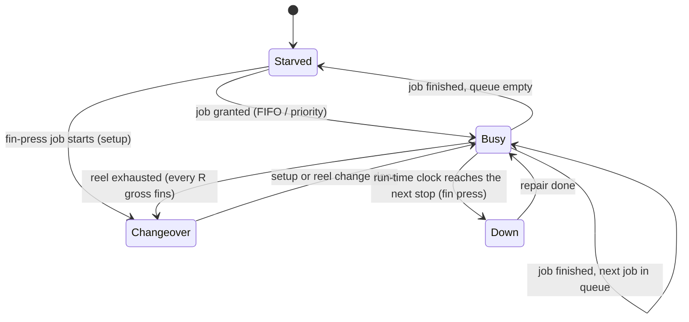
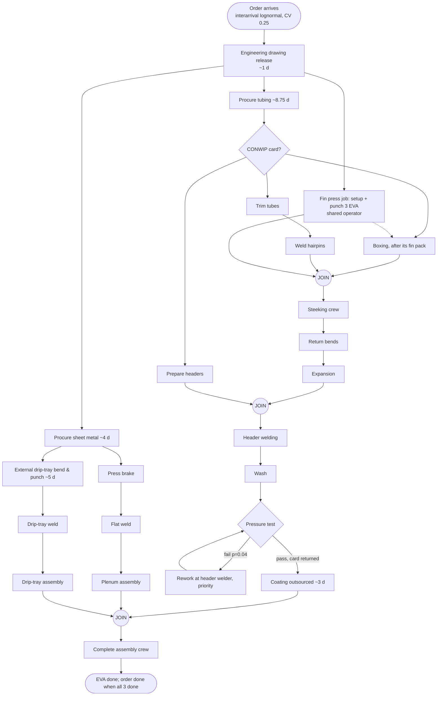

# Model description

> Illustrative and anonymised data ("the Company"). Assumption IDs (A1, A2, ...)
> refer to [`ASSUMPTIONS.md`](ASSUMPTIONS.md).

## 1. Conceptual model

The system is an **order-driven stochastic network**. It has an evaporator (coil)
line, a feeder fin press, in-house sheet metal, outsourced legs (procurement,
external drip-tray bending, coating) and a final assembly that joins the three
sub-assemblies. Demand arrives as work orders of B = 3 EVA.

### 1.1 Entities

| Entity | Attributes | Life cycle |
|---|---|---|
| **Work order** | id, arrival time, due date (arrival + 6 weeks), drawing-release time, tubing arrival, CONWIP card time, completion. It also holds pre-drawn random numbers: one normal per operation per EVA, one per calendar delay and per coating batch, and uniforms and normals for up to 10 tests and reworks per EVA (CRN, A26) | Created at arrival. Complete when its last EVA leaves complete assembly |
| **EVA** (evaporator) | order, index, timestamps (`<op>_ready/start/end` for every operation, join times, stage times), value-added minutes, tests, failed flag | Created with the order. Leaves at complete assembly |
| Fin pack, boxed module, circuits, headers, plenum, drip tray | These are represented as events on gates (one per EVA and stage), not as separate entities | Fire when the sub-assembly's transfer batch is complete |

### 1.2 Resources

| Resource | Servers × crew | Operations | Notes |
|---|---|---|---|
| Fin press / boxing operator | 1 × 1 | fin press job, boxing | **shared** (A6): held for the whole fin-press job, then competes FIFO for boxing |
| Tube trimmer, hairpin welder, return-bend welder, expander, header preparation | 1 × 1 each | one operation each | |
| **Steeking crew** | 1 fixture × 2 operators | steeking | elapsed = labour / (crew × η(crew)) (A8) |
| **Header welder** | 1 × 1 (2 in S3/S6/S7) | header welding, **rework** | rework has priority 0 (A9, A14) |
| Wash bay, pressure-test bay | 1 each | wash, test and retests | |
| Press brake, flat welder, drip-tray welder | 1 × 1 each | plenum and drip-tray operations | |
| Sheet-metal assembler | 1 × 1 | plenum assembly, drip-tray assembly | **shared** |
| Final assembly crew | 1 × 2 operators | complete assembly | |
| Engineering, procurement, external bending, coating | unlimited | calendar delays | lognormal lead times (A3, A10, A11) |

### 1.3 Joins and gates

* **Steeking** (EVA *i*): fin pack *i*, boxed module *i* and circuits *i* must
  all have been released by their transfer-batch gates.
* **Header welding**: expanded coil *i* and prepared headers *i*.
* **Complete assembly**: coil *i* (after coating), plenum *i* and drip tray *i*.
* **Transfer batch** (`orders.transfer_batch`): EVA *i* belongs to group
  ⌊i / TB⌋. A stage's gate releases the whole group once every member has
  finished. TB = 3 (baseline) moves the lot together, and TB = 1 is one-piece flow.
* **CONWIP** (optional, A13b): a card is taken when tubing is kitted and
  returned when the order's last EVA passes the pressure test.

### 1.4 State diagram of a resource (per server)

The model tracks five states. *Blocked* is always 0, because queues are
unlimited (A13). Time in each state is split by activity (for example busy on
fin press vs busy on boxing) and clipped to the measurement window.

## 2. Logic flow

## 3. Random variates

| Quantity | Distribution | Implementation |
|---|---|---|
| Operation time | Family chosen in Phase 3 (lognormal; Weibull for steeking), mean = standard time, CV per operation | `variate_from_z(family, mean, cv, z)` with the order's pre-drawn normal *z*. Gamma and Weibull use the inverse CDF at Φ(z) |
| Fin-press setup | Lognormal(S, 0.25) | fin-press stream (rep, 1) |
| Fin-press scrap | Bernoulli(1 - Q) per fin, so the number scrapped before F good fins is NegBin(F, Q) | gross = F + NegBin |
| Fin-press stops | Poisson with rate 1/MTBF of **run time**. Repairs lognormal(MTTR, 0.5) | remaining run time to the next stop is carried over |
| Reel change | deterministic t_r every R gross fins; the reel carries over between EVA and jobs | |
| Calendar delays | Lognormal(mean days, CV) × 480 min | per order. Coating per transfer batch |
| Test outcome | Bernoulli(p = 0.04) per test | pre-drawn uniforms |
| Rework time | Lognormal(60, 0.15) | pre-drawn normals |
| Order interarrival | Lognormal(B / demand weeks, 0.25) | order stream |
| Steeking mean (outer loop) | Triangular(360, 420, 600) | stream (rep, 9), only when input uncertainty is enabled |

Input analysis (Phase 3) gives these selected families:

<!-- BEGIN:input_analysis -->
| Operation | n | Mean (min) [95 % CI] | CV | Lowest AIC | Lognormal ΔAIC | KS p (selected) | Selected |
|---|---|---|---|---|---|---|---|
| Fin press job (3 EVA) | 40 | 229.2 [221.9, 236.4] | 0.099 | gamma | 0.11 | 0.99 | lognormal |
| Boxing (modules + end panels) | 40 | 101.8 [97.1, 106.4] | 0.143 | lognormal | 0.00 | 0.62 | lognormal |
| Trim Tubes | 40 | 39.0 [37.2, 40.7] | 0.140 | lognormal | 0.00 | 0.72 | lognormal |
| Weld Hairpins | 40 | 212.3 [205.2, 219.5] | 0.105 | lognormal | 0.00 | 0.74 | lognormal |
| Steeking | 40 | 419.5 [393.6, 445.4] | 0.193 | weibull | 2.23 | 0.68 | weibull |
| Weld Return Bends | 40 | 147.7 [140.8, 154.6] | 0.146 | lognormal | 0.00 | 0.12 | lognormal |
| Hydraulic Expanding | 40 | 86.0 [82.9, 89.0] | 0.112 | lognormal | 0.00 | 0.97 | lognormal |
| Prepare Headers | 40 | 117.3 [111.9, 122.6] | 0.143 | gamma | 0.13 | 0.68 | lognormal |
| Header Welding | 40 | 380.4 [361.5, 399.3] | 0.156 | gamma | 0.95 | 0.85 | lognormal |
| Wash Bay | 40 | 45.0 [42.9, 47.2] | 0.148 | lognormal | 0.00 | 0.79 | lognormal |
| Pressure Test | 40 | 91.1 [86.1, 96.1] | 0.172 | lognormal | 0.00 | 0.47 | lognormal |
| Plenum: Press Brake | 40 | 38.2 [36.5, 39.9] | 0.140 | gamma | 0.45 | 0.35 | lognormal |
| Plenum: Flat Welding | 40 | 88.0 [83.7, 92.3] | 0.153 | gamma | 1.14 | 0.73 | lognormal |
| Plenum Assembly | 40 | 61.2 [57.5, 64.9] | 0.190 | gamma | 0.21 | 0.95 | lognormal |
| Drip Tray: Weld | 40 | 102.0 [96.3, 107.8] | 0.176 | lognormal | 0.00 | 0.45 | lognormal |
| Drip Tray Assembly | 40 | 43.9 [41.6, 46.2] | 0.165 | lognormal | 0.00 | 0.67 | lognormal |
| Complete Assembly | 40 | 149.6 [143.6, 155.7] | 0.126 | weibull | 1.79 | 0.78 | lognormal |
<!-- END:input_analysis -->

## 4. Statistical design

| Element | Choice | Justification |
|---|---|---|
| Horizon | 8 warm-up weeks + 52 measured weeks (A16) | One order takes about 4.5 weeks through an empty system, so 8 weeks fills the pipeline. 52 weeks covers a planning year |
| Replications | 300 (quick 30). Sensitivity and sweep runs use 100 | See convergence below |
| Seeds | `SeedSequence(base_seed, spawn_key=(rep, k))`, equivalent to `SeedSequence.spawn` | reproducible, independent replications that do not depend on the number of workers |
| Common random numbers | per-order pre-drawn numbers + per-resource streams (A26) | paired scenario comparisons. `crn_corr` is reported for each paired test |
| Confidence intervals | Student-t on replication means: x̄ ± t(0.975, n-1) · s/√n | replication means are independent and approximately normal |
| Scenario tests | Paired-t on per-replication differences against S0 at the same demand | uses the CRN correlation |
| Two-level Monte Carlo | Outer loop: θ (steeking mean) ~ triangular. Inner loop: process variability. Nested design of 40 θ × 10 replications, analysed with one-way random-effects ANOVA: Var(Y) = Var(E[Y \| θ]) + E[Var(Y \| θ)] | separates input uncertainty from process variability (A27) |
| Validation | 26-week simulated periods vs 26 observed weeks: % error, empirical prediction-interval p, Welch t (A31, A32) | |

<!-- BEGIN:convergence -->
| Metric | Target ± (% of mean) | Replications required | Achieved |
|---|---|---|---|
| lt_mean_days | 0.5 % | 56 | ±0.21 % (300 reps) |
| lt_mean_days | 1 % | 16 | ±0.21 % (300 reps) |
| lt_mean_days | 2 % | 6 | ±0.21 % (300 reps) |
| lt_p90_days | 0.5 % | 192 | ±0.40 % (300 reps) |
| lt_p90_days | 1 % | 50 | ±0.40 % (300 reps) |
| lt_p90_days | 2 % | 15 | ±0.40 % (300 reps) |
| throughput_eva_week | 0.5 % | 213 | ±0.42 % (300 reps) |
| throughput_eva_week | 1 % | 55 | ±0.42 % (300 reps) |
| throughput_eva_week | 2 % | 16 | ±0.42 % (300 reps) |
<!-- END:convergence -->

## 5. Equations used

The fin-press equations (A1-A9), the manual-station metrics (B) and the system
equations (C) are implemented in `src/evapsim/equations.py` and listed in the
README section *The equations*. The analytical model is used three ways:

1. **Hand-calculated VSM**: `results/vsm_hand_calc.csv`, `resource_loads.csv`.
2. **Verification**: the deterministic simulation must reproduce the critical-path
   lead time, the utilisations, the weekly output and the fin-press job time
   *exactly*.
3. **Cross-checks**: the stochastic fin-press mean must be within 1 % of T_job,
   Little's law must hold, and Kingman must agree on an M/G/1 bench and
   bracket the network queue at steeking.

<!-- BEGIN:deterministic -->
| Case | Quantity | Hand calc | Simulated (min-max) | Exact |
|---|---|---|---|---|
| baseline (transfer batch 3) | order lead time (min) | 10848.00 | 10848.00 | yes |
| baseline (transfer batch 3) | utilisation: steeking_crew | 0.5250 | 0.5250 | yes |
| baseline (transfer batch 3) | utilisation: header_welder | 0.4800 | 0.4800 | yes |
| baseline (transfer batch 3) | utilisation: fin_press_operator | 0.2203 | 0.2203 | yes |
| baseline (transfer batch 3) | EVA per week | 3.0000 | 3.0000 | yes |
| baseline (transfer batch 3) | fin press job (min) | 228.61 | 228.61 - 228.61 | yes |
| transfer batch 1 | order lead time (min) | 8536.00 | 8536.00 | yes |

_19 of 19 checked quantities match exactly (all 15 resource utilisations included). Source: `results/deterministic_check.csv`._
<!-- END:deterministic -->

## 6. Mapping model elements to VSM elements

| VSM element | Model element | Source |
|---|---|---|
| Process box | Operation on a resource (one SimPy request per EVA) | `operations`, `resources` |
| C/T (cycle time) | `op_mean_min` per EVA (elapsed, including the crew effect) | config |
| Operators | crew × servers of the resource | config |
| OEE / uptime (fin press) | equations A4-A6; the stochastic run reproduces T_job | config + simulation |
| Yield (FPY) | 1 - first-test failures / first tests (pressure test); Q (fin press) | simulation |
| Utilisation | busy share (active share for the fin press) | simulation |
| Inventory triangle | average EVA queuing in front = λ × mean queue time (Little) | simulation |
| Push arrow / one-piece-flow arrow | transfer-batch gate (TB = 3 striped / TB = 1 plain) | `orders.transfer_batch` |
| Outsourced box | calendar delay (procurement, external bending, coating) | `lead_times` |
| Production control | arrival process, drawing release, release rule (push / CONWIP) | `demand`, `release` |
| Kaizen burst | scenario override | `scenarios.yaml` |
| Timeline ladder | critical coil path: delays and queue times (upper), processing times (lower) | simulation |
| Lead time | order lead time from arrival to the last EVA completed | simulation |
| VA ratio | value-added minutes per EVA / mean EVA lead time (A30) | simulation |
